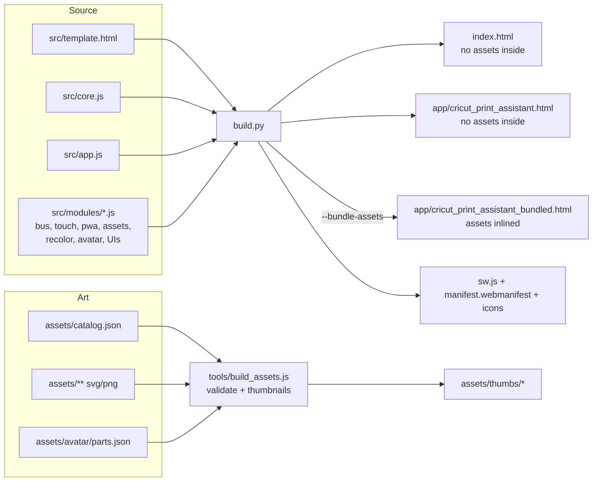
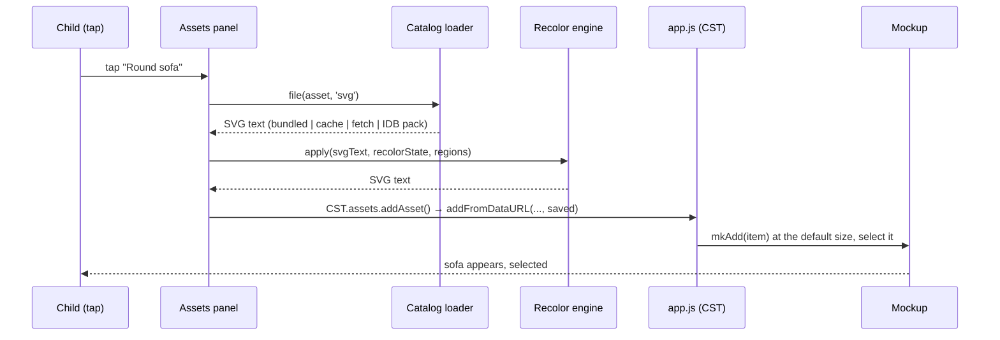
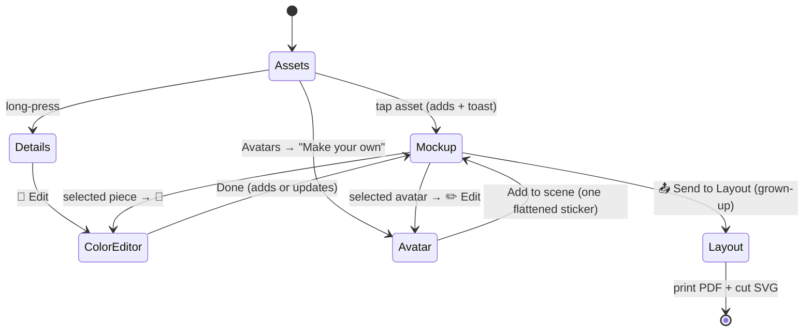
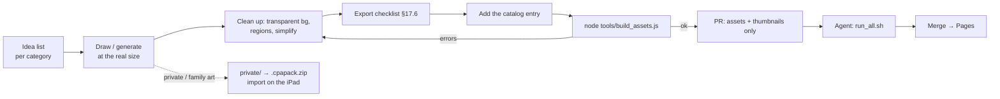

# BUILD.md – Assets, Color editor and Avatar builder (iPad-ready)

This is the build plan for the next big chunk of work on Cricut Print Assistant. It goes from start to finish:

- goals and architecture;
- schemas and wireframes;
- numbered milestones with line-by-line acceptance criteria;
- code skeletons, the file map, risks, budgets and accessibility;
- the **art pipeline** for the people making the images.

**Read [AGENT_MEMORY.md](AGENT_MEMORY.md) first.** It has the invariants that must never break and the working rules. [AGENT_HANDOFF.md](AGENT_HANDOFF.md) is the code tour of what exists today.

> **Status:** P1–P4 code is in, with a few original placeholder drawings. Still open: a real catalog of at least 30 assets, a full avatar set (6 options per main slot), and the physical iPad checklist in §12.3.

---

## Contents

1. [Vision and users](#1-vision-and-users)
2. [Goals and non-goals](#2-goals-and-non-goals)
3. [Architecture](#3-architecture)
4. [Data schemas (with examples)](#4-data-schemas)
5. [UI wireframes](#5-ui-wireframes)
6. [Phase 1 – iPad-ready (PWA, touch)](#6-phase-1--ipad-ready)
7. [Phase 2 – Assets tab](#7-phase-2--assets-tab)
8. [Phase 3 – Color editor](#8-phase-3--color-editor)
9. [Phase 4 – Avatar builder](#9-phase-4--avatar-builder)
10. [Code skeletons](#10-code-skeletons)
11. [File map (target)](#11-file-map-target)
12. [Testing strategy and the iPad manual checklist](#12-testing-strategy)
13. [Performance budgets](#13-performance-budgets)
14. [Status table](#14-status-table)
15. [Risks and mitigations](#15-risks-and-mitigations)
16. [Accessibility and a kid-friendly UI](#16-accessibility-and-a-kid-friendly-ui)
17. [Art pipeline spec (for the image makers)](#17-art-pipeline-spec)
18. [Licensing rules](#18-licensing-rules)
19. [Glossary](#19-glossary)

---

## 1. Vision and users

**Who:** a parent and a child making sticker scenes (for example a sticker dollhouse) together. They work mostly on an **iPad**, and on a laptop for printing and cutting.

**What it should feel like:**

1. Open the app from the iPad home screen. It works offline.
2. Go to the **Assets** tab and browse categories: rooms, furniture, decor, items, avatars and so on. Tap a sofa and it appears in the Mockup at a sensible real size.
3. Tap **🎨 Colors** and make the sofa purple. It prints purple and the cut still fits.
4. Make a character in the **Avatar builder**, video-game style:
   - skin, hair, eyes, outfit, shoes and accessories;
   - a 🎲 randomize button and a gallery of saved avatars.

   Send it to the Mockup as one sticker.
5. When the scene looks right: **Send to Layout → print PDF + cut SVG**. This existing flow doesn't change.

The parent (and the coding agent) make the image assets; the child uses them.

## 2. Goals and non-goals

### Goals

| # | Goal | Measured by |
|---|---|---|
| G1 | Works well on iPad Safari and as an installed PWA, offline | P1 acceptance and the iPad manual checklist (§12.3) |
| G2 | A browsable, searchable asset library with categories and real default sizes | P2 acceptance |
| G3 | Private asset packs can be imported locally and **never** reach the public repo | P2·M5 + the privacy checks |
| G4 | Recolor SVG assets by named regions; prints and cuts still line up | P3 acceptance + alignment tests |
| G5 | A layered avatar builder that exports one flattened sticker with a contour | P4 acceptance |
| G6 | The current tool keeps working **unchanged**: cut/print alignment, calibration, sheet codes, byte-identity tests and the single offline file | `test/run_all.sh` green at every commit |
| G7 | A child can use the Assets / Colors / Avatar flows without reading much | §16 checklist |

### Non-goals (for this plan)

- No accounts, server, cloud sync, analytics or ads. The only network calls allowed are same-origin fetches of `assets/` when the page is served over http(s).
- No in-app drawing or painting tool beyond recoloring. The only raster editing is the PNG tint/hue recolor in P3.
- No asset marketplace, no third-party packs in the public repo, no copyrighted characters.
- No change to the calibration model, the sheet codes, the 0.25 in anchor or the cut SVG format.
- No framework (React etc.) and no bundler. Plain ES2018+ JS, built by `build.py`.
- No native iOS app; the PWA is the iPad app.
- No printing from the iPad straight to the cutter. The hand-off stays PDF + SVG.

## 3. Architecture

### 3.1 Today (don't break)

```
src/template.html ─┐
vendor/jspdf…      ├─ build.py ──► index.html (Pages)  +  app/cricut_print_assistant.html (download)
src/core.js        │              one file, no network, ~640 KB
src/app.js         │
src/howto.html    ─┘
```

- `core.js` is pure math with no DOM (`window.CSTCore`). `app.js` holds the UI and state, and the test hooks live on `window.CST`.
- An image becomes an **item**: `{ id, name, dataURL, img, wIn, hIn, qty, shape, offsetIn, border, warp, … }`. `processed(it)` is what prints and cuts.
- The Mockup holds **nodes** (copies) that point at items.

### 3.2 Target: the same single file, plus optional assets



**Decisions, made up front to avoid rework:**

1. **The app is still one HTML file.**
   - New code goes in `src/modules/*.js`. Each module is an IIFE that talks to the app only through `window.CST` hooks and a tiny event bus (§10.1).
   - `build.py` concatenates the modules **in a fixed order** (`src/modules/ORDER`) into a new `/*MODULES*/` placeholder after `/*APP*/`.
2. **The default build fetches assets instead of embedding them.**
   - On Pages, `index.html` fetches `assets/catalog.json` and the files from the same origin, and the service worker caches them for offline use.
   - The app file stays small, art updates don't touch the app's bytes, and the existing byte-identity tests stay valid.
3. **An optional bundled build gives true single-file offline use.**
   - `python3 build.py --bundle-assets` writes `app/cricut_print_assistant_bundled.html`. The catalog and every public asset are inlined in a `<script type="application/json" id="cstAssets">` block, with the files as data URLs.
   - This is the file to open from disk (`file://`), where `fetch` of local files is blocked.
   - The loader tries **bundled → fetched → none** (§10.2).
4. **The app works with zero assets.** If no source is available (e.g. the plain file opened from disk), the Assets tab says "No library here. Use the bundled file or the web version, or import a pack." Everything else works as today.
5. **An asset becomes a normal item.**
   - Adding an asset calls the existing `addFromDataURL(name, dataURL, srcURL, isSvg, saved)` with `saved = { wIn, hIn, shape, offsetIn, asset: {…} }`.
   - From then on it's a regular image: Layout, Mockup, warp, steps, saves and exports all treat it the same.
   - **No asset code runs in the export paths.**
6. **Recolors and avatars produce a new SVG string → data URL.**
   - The recolor state or avatar spec is kept in `it.asset`, so it can be re-edited.
   - The item's `dataURL` stays self-contained, so a project file opens even without the pack.
7. **Private packs live only in IndexedDB** (the `cst-assets` database) and in the user's own files. They're imported with a file picker (`.cpapack.zip` or `.cpapack.json`), and are never fetched from or written to the repo.
8. **The service worker and manifest are separate files** next to `index.html`.
   - A service worker can't be inlined.
   - It's registered only when `location.protocol` is `https:`, or on `http://localhost` for tests. On `file://` nothing changes.
9. **Thumbnails and validation run in headless Chrome** (`tools/build_assets.js`, using the puppeteer-core already in `test/`). Thumbnails are rendered by the same engine as the app, and no Python dependencies are added.

### 3.3 Runtime data flow



### 3.4 Changes to existing invariants

- **Invariant 8, "Single offline file: no fetches"**, becomes: the **core** (Layout, exports, calibration, Mockup) never needs the network.
  - The only allowed fetches are same-origin GETs under `assets/` (plus the service worker's precache).
  - They happen **only** when the page is served over http(s), and they must fail gracefully.
  - No CDNs, web fonts, analytics or third-party URLs, ever.
- Every other invariant in AGENT_MEMORY stays as it is.

### 3.5 Storage

| Store | What | Notes |
|---|---|---|
| localStorage `cst.settings` | adds `ui: { kidMode, bigTargets, assetsView }` | small |
| localStorage `cst.mockup` | unchanged; nodes may point to asset items by name | |
| IndexedDB `cst-mockups` | unchanged (named saves, autosave) | |
| IndexedDB `cst-assets` v1 (new) | `packs` {id, meta, catalog, t}, `files` {key `packId/path`, blob, type}, `avatars` {id, name, t, spec, thumb}, `recents` {assetId, t} | `navigator.storage.persist()` is requested on the first write |
| Cache Storage `cpa-<hash>` | app shell + `assets/**` (service worker) | versioned by the build hash |

## 4. Data schemas

All JSON is UTF-8, indented with 2 spaces in the repo, and validated by `tools/build_assets.js`. **Units are inches**, like the app. Colours are lowercase `#rrggbb`.

### 4.1 `assets/catalog.json` (public catalog, schema `cpa-catalog/1`)

```json
{
  "schema": "cpa-catalog/1",
  "pack": {
    "id": "core",
    "name": "Starter pack",
    "version": "1.0.0",
    "license": "CC0-1.0",
    "author": "Cricut Print Assistant contributors"
  },
  "categories": [
    { "id": "rooms",     "name": "Rooms",     "icon": "🏠", "order": 10 },
    { "id": "furniture", "name": "Furniture", "icon": "🛋️", "order": 20 },
    { "id": "decor",     "name": "Decor",     "icon": "🖼️", "order": 30 },
    { "id": "items",     "name": "Items",     "icon": "🧸", "order": 40 },
    { "id": "avatars",   "name": "Avatars",   "icon": "🙂", "order": 50 },
    { "id": "nature",    "name": "Nature",    "icon": "🌿", "order": 60 },
    { "id": "food",      "name": "Food",      "icon": "🍰", "order": 70 }
  ],
  "assets": [
    {
      "id": "core.furniture.sofa-round",
      "name": "Round sofa",
      "category": "furniture",
      "tags": ["living room", "sofa", "couch", "seat"],
      "size": { "w": 2.5, "h": 1.4 },
      "files": { "svg": "furniture/sofa-round.svg", "thumb": "thumbs/furniture/sofa-round.webp" },
      "cut": { "shape": "contour", "offset": 0.04 },
      "regions": [
        { "id": "fabric",  "name": "Fabric",   "default": "#7fb3d5" },
        { "id": "cushion", "name": "Cushions", "default": "#a9cce3" },
        { "id": "legs",    "name": "Legs",     "default": "#8b5a2b" }
      ],
      "palettes": ["pastel", "wood"],
      "view": "iso-left",
      "license": "CC0-1.0",
      "author": "Cricut Print Assistant contributors",
      "source": "original",
      "added": "2026-12-01"
    },
    {
      "id": "core.rooms.bedroom-iso",
      "name": "Bedroom (isometric)",
      "category": "rooms",
      "tags": ["room", "bedroom", "floor", "wall"],
      "size": { "w": 8.0, "h": 6.0 },
      "files": { "svg": "rooms/bedroom-iso.svg", "thumb": "thumbs/rooms/bedroom-iso.webp" },
      "cut": { "shape": "rect", "offset": 0 },
      "regions": [
        { "id": "wall-left",  "name": "Left wall",  "default": "#f6d5e0" },
        { "id": "wall-right", "name": "Right wall", "default": "#f3c6d5" },
        { "id": "floor",      "name": "Floor",      "default": "#e8cfa8" },
        { "id": "trim",       "name": "Trim",       "default": "#ffffff" }
      ],
      "role": "backdrop",
      "license": "CC0-1.0",
      "author": "Cricut Print Assistant contributors",
      "source": "ai-generated-by-owner",
      "tool": "<name of the image tool used>",
      "added": "2026-12-01"
    },
    {
      "id": "core.items.teddy",
      "name": "Teddy",
      "category": "items",
      "tags": ["toy", "bear"],
      "size": { "w": 1.2, "h": 1.4 },
      "files": {
        "png": "items/teddy.png",
        "thumb": "thumbs/items/teddy.webp",
        "masks": { "fur": "items/teddy.mask-fur.png" }
      },
      "cut": { "shape": "contour", "offset": 0.04 },
      "regions": [{ "id": "fur", "name": "Fur", "default": "#b07a4a", "mode": "tint" }],
      "license": "CC0-1.0",
      "author": "Cricut Print Assistant contributors",
      "source": "original",
      "added": "2026-12-01"
    }
  ]
}
```

**Field rules**

| Field | Required | Rule |
|---|---|---|
| `id` | ✓ | `^[a-z0-9]+(\.[a-z0-9-]+){2}$`, i.e. `pack.category.slug`. Unique across all loaded packs. **Never rename it** once published, because saves refer to it. If a rename is unavoidable, add `aliases: [oldId]`. |
| `name` | ✓ | 1–40 characters, easy for a child to read |
| `category` | ✓ | one of `categories[].id` |
| `tags` | – | 0–12 lowercase words, used by search |
| `size.w`, `size.h` | ✓ | inches, 0.25–11. The aspect must match the file's aspect within 1%. |
| `files.svg` or `files.png` | ✓ (one) | path relative to the pack root. `svg` is preferred. |
| `files.thumb` | ✓ | generated by the build script: WebP, 256 px on the longest side |
| `files.masks` | – | PNG assets only: `{ regionId: path }`, grayscale masks the same size as the PNG |
| `cut.shape` | ✓ | `contour` \| `rect` \| `rounded` (maps to `it.shape`) |
| `cut.offset` | – | inches (maps to `it.offsetIn`); default 0 |
| `regions[]` | – | the recolorable regions. Each `id` must exist in the SVG as `data-region` (or as a mask for PNGs). |
| `regions[].mode` | – | SVG: `fill` (default) \| `stroke` \| `both`. PNG: `tint` \| `hue`. |
| `palettes` | – | ids from `palettes.json`, shown first in the swatch picker |
| `role` | – | `sticker` (default) \| `backdrop` (the Assets tab also offers "Use as Mockup background") |
| `view` | – | `front` \| `iso-left` \| `iso-right` \| `top`; used as a filter hint |
| `license` | ✓ | an SPDX id. The public catalog allows **only** `CC0-1.0` (§18). |
| `author` | ✓ | a generic credit in the public repo. No personal names. |
| `source` | ✓ | `original` \| `ai-generated-by-owner` \| `cc0-third-party` |
| `tool` | if AI | the generator's name. Never commit prompts that contain personal data. |
| `sourceUrl` | if third-party CC0 | the original URL |
| `added` | ✓ | ISO date |

### 4.2 `assets/palettes.json` (schema `cpa-palettes/1`)

```json
{
  "schema": "cpa-palettes/1",
  "palettes": [
    { "id": "pastel", "name": "Pastel", "colors": [
      { "hex": "#f7c5d5", "name": "Bubblegum" }, { "hex": "#c5e1f7", "name": "Sky" },
      { "hex": "#d5f7c5", "name": "Mint" },      { "hex": "#f7ecc5", "name": "Butter" },
      { "hex": "#e1c5f7", "name": "Lilac" },     { "hex": "#ffffff", "name": "White" } ] },
    { "id": "wood", "name": "Wood", "colors": [
      { "hex": "#8b5a2b", "name": "Walnut" }, { "hex": "#c19a6b", "name": "Oak" }, { "hex": "#e8cfa8", "name": "Birch" } ] },
    { "id": "skin", "name": "Skin tones", "colors": [
      { "hex": "#f9dcc4", "name": "Tone 1" }, { "hex": "#f1c27d", "name": "Tone 2" }, { "hex": "#e0ac69", "name": "Tone 3" },
      { "hex": "#c68642", "name": "Tone 4" }, { "hex": "#8d5524", "name": "Tone 5" }, { "hex": "#5c3a1e", "name": "Tone 6" } ] },
    { "id": "hair", "name": "Hair", "colors": [
      { "hex": "#2b1b10", "name": "Black-brown" }, { "hex": "#4a2c1a", "name": "Brown" }, { "hex": "#a0522d", "name": "Auburn" },
      { "hex": "#e6be8a", "name": "Blonde" }, { "hex": "#d65a9a", "name": "Pink" }, { "hex": "#5b8def", "name": "Blue" } ] },
    { "id": "eyes", "name": "Eyes", "colors": [
      { "hex": "#3b6ea5", "name": "Blue" }, { "hex": "#5a8f3c", "name": "Green" }, { "hex": "#6b4423", "name": "Brown" }, { "hex": "#7a7a7a", "name": "Grey" } ] }
  ]
}
```

Every colour has a **name**, and the UI shows it next to the swatch (for colour-blind users and for reading aloud).

### 4.3 Item extension (`it.asset`), saved in projects

```json
{
  "asset": {
    "id": "core.furniture.sofa-round",
    "pack": "core",
    "packVersion": "1.0.0",
    "kind": "svg",
    "recolor": { "fabric": "#b39ddb", "legs": "#5d4037" },
    "avatar": null
  }
}
```

- `projectData()` writes `asset` **only when it's present**, the same way `warp` is written. Projects without assets stay byte-identical.
- `dataURL` is always the **recolored or composed** SVG/PNG, so a project opens without the pack. `asset` lets the editor reopen it with the original regions.
- **A recolor is per image** (all copies). "🎨 Recolor only this copy" duplicates the item first ("Round sofa (2)", a new id, and the node re-pointed). It's the same idea as the warp split, but done up front.

### 4.4 Private pack format (`.cpapack.zip` / `.cpapack.json`)

A **zip** with the same layout as `assets/`:

```
my-pack.cpapack.zip
├── pack.json            # a cpa-catalog/1 document; pack.id must be unique and not "core"
├── palettes.json        # optional
├── furniture/…svg
├── thumbs/…webp         # optional; generated on import if missing
└── avatar/parts.json    # optional avatar parts (§4.5)
```

or a single **JSON** file, which is easier to make with scripts:

```json
{
  "schema": "cpa-pack-inline/1",
  "catalog": { "schema": "cpa-catalog/1",
               "pack": { "id": "family", "name": "Family pack", "version": "1.0.0", "license": "LicenseRef-Private", "author": "private" },
               "categories": [], "assets": [] },
  "files": { "furniture/bunk-bed.svg": "data:image/svg+xml;base64,…" }
}
```

- Private packs may use `license: "LicenseRef-Private"`. The public validator **rejects** that licence in `assets/`.
- Import keeps the files in IndexedDB (`cst-assets.files`) and the catalog in `packs`. Exporting a pack writes the same format.
- Pack ids are namespaced, so the asset ids look like `family.furniture.bunk-bed`.
- The zip reader uses `DecompressionStream('deflate-raw')`, which needs Safari ≥ 16.4 or Chrome ≥ 80. Where it's missing, the error says "Use the .cpapack.json form".

### 4.5 Avatar parts catalog: `assets/avatar/parts.json` (schema `cpa-avatar/1`)

```json
{
  "schema": "cpa-avatar/1",
  "template": {
    "id": "kid-v1",
    "viewBox": [0, 0, 1000, 1500],
    "sizeIn": { "w": 2.0, "h": 3.0 },
    "anchors": {
      "head": [500, 400], "neck": [500, 590],
      "shoulderL": [330, 650], "shoulderR": [670, 650],
      "handL": [250, 960], "handR": [750, 960],
      "waist": [500, 930],
      "footL": [420, 1440], "footR": [580, 1440]
    }
  },
  "slots": [
    { "id": "hairBack",  "name": "Hair (back)",    "z": 10, "optional": true },
    { "id": "body",      "name": "Body",           "z": 20, "required": true },
    { "id": "bottom",    "name": "Bottoms",        "z": 30, "optional": true },
    { "id": "shoes",     "name": "Shoes",          "z": 35, "optional": true },
    { "id": "top",       "name": "Top",            "z": 40, "optional": true },
    { "id": "neckwear",  "name": "Necklace/Scarf", "z": 45, "optional": true },
    { "id": "face",      "name": "Face",           "z": 50, "required": true },
    { "id": "eyes",      "name": "Eyes",           "z": 55, "required": true },
    { "id": "mouth",     "name": "Mouth",          "z": 56, "required": true },
    { "id": "brows",     "name": "Eyebrows",       "z": 57, "optional": true },
    { "id": "glasses",   "name": "Glasses",        "z": 58, "optional": true },
    { "id": "hairFront", "name": "Hair (front)",   "z": 60, "optional": true },
    { "id": "hat",       "name": "Hat",            "z": 70, "optional": true },
    { "id": "handheld",  "name": "Holding",        "z": 80, "optional": true }
  ],
  "colorSlots": {
    "skin": { "name": "Skin", "palette": "skin", "default": "#f1c27d", "regions": ["skin"] },
    "hair": { "name": "Hair", "palette": "hair", "default": "#4a2c1a", "regions": ["hair"] },
    "eyes": { "name": "Eyes", "palette": "eyes", "default": "#3b6ea5", "regions": ["iris"] }
  },
  "parts": [
    { "id": "core.avatar.body-01", "slot": "body", "name": "Body", "file": "avatar/body/body-01.svg",
      "regions": ["skin"], "license": "CC0-1.0", "author": "Cricut Print Assistant contributors", "source": "original" },
    { "id": "core.avatar.hair-bob-front", "slot": "hairFront", "name": "Bob", "file": "avatar/hair/bob-front.svg",
      "pairs": "core.avatar.hair-bob-back", "follows": "head", "regions": ["hair"],
      "license": "CC0-1.0", "author": "Cricut Print Assistant contributors", "source": "original" },
    { "id": "core.avatar.hair-bob-back", "slot": "hairBack", "name": "Bob (back)", "file": "avatar/hair/bob-back.svg",
      "hiddenInPicker": true, "follows": "head", "regions": ["hair"],
      "license": "CC0-1.0", "author": "Cricut Print Assistant contributors", "source": "original" },
    { "id": "core.avatar.hat-beanie", "slot": "hat", "name": "Beanie", "file": "avatar/hat/beanie.svg",
      "hides": ["hairFront"], "swapTo": { "hairBack": "core.avatar.hair-short-back" }, "follows": "head",
      "regions": ["hat", "pompom"], "license": "CC0-1.0", "author": "Cricut Print Assistant contributors", "source": "original" }
  ],
  "presets": [
    { "id": "preset-sunny", "name": "Sunny",
      "parts": { "body": "core.avatar.body-01", "face": "core.avatar.face-round", "eyes": "core.avatar.eyes-happy",
                 "mouth": "core.avatar.mouth-smile", "hairFront": "core.avatar.hair-bob-front" },
      "colors": { "skin": "#e0ac69", "hair": "#2b1b10" } }
  ]
}
```

**Rules**

- Parts are drawn **in place** on the shared template artboard, in absolute coordinates, so the default composition is just stacking the layers.
- `anchors` matter only for:
  - body variants with different proportions: a body part may declare its own `anchors`, and parts with `"follows": "<anchor>"` get shifted by `bodyAnchor − templateAnchor`;
  - future poses.
- With no `follows`, a part isn't moved. Clothes (`top`, `bottom`, `shoes`) are normally drawn **in place on the body they fit** and have no `follows`; the shoulder/hand/foot anchors are drawing guides, not hard limits. If a body variant has a different silhouette (e.g. a slimmer chibi torso), either draw clothes for that body, or give that body its own `anchors` (e.g. `"shoulderL": [380, 660]`) and set `"follows": "shoulderL"`/`"neck"`/`"waist"` on the clothes that should move with it.
- **Template size per source.** Each `parts.json` (core or a pack) keeps its own `template.viewBox`. The composed SVG uses the chosen body's template (its `viewBox` and `sizeIn`); parts from a source with a different artboard are mapped onto it viewBox-to-viewBox, and `follows` offsets are computed in the output units. The core template is 1000 × 1500 = 2 × 3 in.
- **Avatar parts in packs.** A `.cpapack.zip` may carry `avatar/parts.json` (point elsewhere with `"avatar": "path/parts.json"` in `pack.json`), its SVGs, and `palettes.json` (at the zip root or next to `parts.json`). Part `file` paths are relative to the `parts.json` folder. The loader merges every pack's parts, slots, colour slots and presets into `CST.assets.avatarParts()` (pack presets first; a preset id that clashes with an earlier one is prefixed `<pack>:`), and merges palettes by id. A broken `avatar/parts.json` makes the import fail with the JSON path. Both `cpa-avatar/1` and the older `cpa-avatar-parts/1` schema names are accepted.
- **Raster parts and per-body canvases.** A part whose `file` is a PNG (or `"kind": "raster"`) is embedded in the composed SVG as an `<image>` covering its artboard. A body can define its own artboard with `"canvas": { "px": [900, 1200], "dpi": 300 }` (or `{ "viewBox": [...], "sizeIn": { "w", "h" } }`); the sticker then comes out at px ÷ dpi inches. Overlays drawn on the same canvas as their body are stacked with zero offset. The export is still one flattened sticker, and the contour cut goes around the union of every layer.
- **Body-specific parts.** `"bodies": ["<body id>", …]` limits a part to those bodies; the builder only offers parts that fit the chosen body and clears the rest when you switch bodies (`CST.avatar.clean`). A body with `"exclusive": true` takes only parts that list it, so generic parts (faces, hair) don't appear on it. Required slots come from the parts.json the chosen body belongs to. Optional `thumb` paths (relative to parts.json) on parts and presets show as button thumbnails. Tapping a chosen item again (or **None**) takes it off.
- Validate a private pack folder (outside the repo) with `node tools/build_assets.js --check --private --root <folder>`. `--private` allows `LicenseRef-Private`, accepts `pack.json` and avatar-only packs, and refuses to run on any folder inside the repo, so the public `assets/` check stays CC0-only.
- `pairs`: choosing the part also adds its partner in the partner's slot (front + back hair).
- `hides`: these slots are dropped while this part is chosen.
- `swapTo`: replaces the part in those slots (e.g. a short back-hair under a beanie).
- `hiddenInPicker`: the part never shows as an option of its own.

### 4.6 Avatar spec (saved in `cst-assets.avatars` and in `it.asset.avatar`)

```json
{
  "schema": "cpa-avatar-spec/1",
  "template": "kid-v1",
  "name": "Pirate",
  "parts": { "body": "core.avatar.body-01", "face": "core.avatar.face-round", "eyes": "core.avatar.eyes-happy",
             "mouth": "core.avatar.mouth-smile", "hairFront": "core.avatar.hair-bob-front", "hairBack": "core.avatar.hair-bob-back",
             "top": "core.avatar.top-stripes", "bottom": "core.avatar.bottom-shorts", "shoes": "core.avatar.shoes-sneakers", "hat": null },
  "colors": { "skin": "#c68642", "hair": "#2b1b10", "eyes": "#3b6ea5" },
  "partColors": { "core.avatar.top-stripes": { "stripe-a": "#e57373", "stripe-b": "#ffffff" } },
  "locks": { "hairFront": true },
  "seed": 12345
}
```

## 5. UI wireframes

### 5.1 Tabs (after P2)

```
┌────────────────────────────────────────────────────────────────────────────┐
│ ✂️ Cricut Print Assistant  [Assets] [Mockup] [Avatar] [Layout] [Calibrate] [How to] │
│                                                     [🧒 Kid mode ◉] [⋯]     │
└────────────────────────────────────────────────────────────────────────────┘
```

- **Kid mode** (on by default on touch devices; toggle it in ⋯):
  - only **Assets · Mockup · Avatar** show;
  - Layout, Calibrate and How to sit behind a **"Grown-ups" button you hold for 2 s**. It's a guardrail against accidents, not security.
- Tab order: Assets first in Kid mode, Layout first otherwise.

### 5.2 Assets tab (iPad landscape, about 1180 × 820 pt)

```
┌──────────────┬─────────────────────────────────────────────────────────────┐
│ 🔍 [search…] │  Furniture · 42                            [▦ grid] [≡ list] │
│──────────────│─────────────────────────────────────────────────────────────│
│ 🏠 Rooms     │ ┌──────┐ ┌──────┐ ┌──────┐ ┌──────┐ ┌──────┐ ┌──────┐      │
│ 🛋️ Furniture◀│ │ img  │ │ img  │ │ img  │ │ img  │ │ img  │ │ img  │      │
│ 🖼️ Decor     │ │Sofa  │ │Bed   │ │Chair │ │Shelf │ │Bath  │ │TV    │      │
│ 🧸 Items     │ │2.5 in│ │3 in  │ │1 in  │ │2 in  │ │3 in  │ │1.5 in│      │
│ 🙂 Avatars   │ └──────┘ └──────┘ └──────┘ └──────┘ └──────┘ └──────┘      │
│ 🌿 Nature    │   tap = add to the scene · long-press = details / colours   │
│ 🍰 Food      │                                                             │
│──────────────│                                                             │
│ ⭐ Recent     │                                                             │
│ 📦 My packs  │                                                             │
│ [+ Import]   │                                                             │
└──────────────┴─────────────────────────────────────────────────────────────┘
 Toast: "Sofa added to your scene ✓   [Go to Mockup]  [Undo]"
```

In portrait (about 820 × 1180), the categories become a row of chips above the grid that you can scroll sideways.

### 5.3 Asset details sheet (long-press, or ⓘ in list view)

```
┌───────────────────────────── Round sofa ─────────────────────── [✕] ┐
│  ┌──────────────┐   Size: 2.5 × 1.4 in   [– smaller] [+ bigger]      │
│  │   preview    │   Colors:  Fabric ●  Cushions ●  Legs ●  [🎨 Edit] │
│  └──────────────┘   Tags: living room, sofa                          │
│  License: CC0 · by Cricut Print Assistant contributors               │
│  [ Add to scene ]   [ Add 2 ]   [ Use as background ] (rooms only)   │
└──────────────────────────────────────────────────────────────────────┘
```

### 5.4 Color editor (P3)

```
┌───────────────────────── 🎨 Colors – Round sofa ─────────── [Done] ┐
│ ┌────────────────────┐  Part:  (●) Fabric  ( ) Cushions  ( ) Legs   │
│ │                    │                                              │
│ │   live preview     │  Pastel:  ● ● ● ● ● ●   (long-press = name)  │
│ │ (tap a part to     │  Wood:    ● ● ●                               │
│ │  pick it)          │  More:    [🌈 colour wheel]  Lilac #e1c5f7    │
│ └────────────────────┘  [↺ Reset part] [↺ Reset all] [🎲 Surprise]   │
│  Applies to: (●) every copy   ( ) only this copy (makes a new image)│
└──────────────────────────────────────────────────────────────────────┘
```

### 5.5 Avatar builder (P4)

```
┌──────────────────────────────── Avatar ────────────────────────────────────┐
│ ┌───────────────┐ [Body][Face][Eyes][Hair][Top][Bottom][Shoes][Hat][Extras]│
│ │               │ ┌────┐┌────┐┌────┐┌────┐┌────┐┌────┐                     │
│ │   big live    │ │ ◯  ││ ◯  ││ ◯  ││ ◯  ││ ✕  ││ ◯  │  ← part thumbnails  │
│ │   preview     │ └────┘└────┘└────┘└────┘└────┘└────┘    (✕ = none)       │
│ │               │ Hair colour:  ● ● ● ● ● ●      🔒 keep hair              │
│ └───────────────┘                                                           │
│ [🎲 Randomize] [↺ Undo] [💾 Save to gallery] [➕ Add to scene]              │
│ Gallery: [🙂][🙂][🙂][🙂]   (tap = load · long-press = rename / delete)     │
└────────────────────────────────────────────────────────────────────────────┘
```

### 5.6 Screen flow



## 6. Phase 1 – iPad-ready

**Outcome:** the current app is pleasant on an iPad (touch, pinch, rotate, big targets), installable and offline from Pages, and robust to iPad Safari quirks. There's no asset work in this phase.

### P1 · M1 – Module plumbing in build.py (no visible change) ← **start here**

Tasks
1. Add a `/*MODULES*/` placeholder in `src/template.html`, in the same `<script>` right after `/*APP*/`.
2. `build.py`: concatenate `src/modules/*.js` in the order given in `src/modules/ORDER` (one file name per line, `#` comments). Assert there's no `</script`. Fail if a file in `src/modules/` isn't listed, or a listed file is missing.
3. Add `src/modules/bus.js` (the event bus + the `CST.registerModule` registry, §10.1).
4. In `app.js`, add one-line emits: `CST.bus.emit('items:changed')` at the end of `refresh()`'s timeout, `'mockup:changed'` in `mkCommit()`, and `'tab:shown'` in the tab switch. Guard each with `window.CST && CST.bus &&`.
5. Expose the hooks the modules need on `window.CST`: `mkAdd`, `mkCommit`, `download`, `toast`, `addFromDataURL` (exists), `mkSelect` (exists), `refresh` (exists), `renderMock` (exists).

Acceptance
- [ ] 1.1.1 `python3 build.py` writes the same outputs as before. With only `bus.js` added, `index.html` differs from the previous build only by the module text and the emits.
- [ ] 1.1.2 `test/run_all.sh` passes with no test changes (all byte-identity tests).
- [ ] 1.1.3 The new `test/modules_test.js` checks:
  - the page loads with no console errors;
  - `CST.registerModule` exists, and `CST.bus.on`/`emit` work;
  - registering the same name twice throws;
  - `items:changed` fires after `refresh()`.
- [ ] 1.1.4 A module file left out of `ORDER` makes `build.py` exit non-zero with a clear message.
- [ ] 1.1.5 AGENT_HANDOFF's "Build pipeline" section documents `/*MODULES*/` and `ORDER`, and the status table in §14 is updated.

### P1 · M2 – Touch input: targets and gestures on the Mockup and Layout canvases

Tasks
1. `src/modules/touch.js`: a gesture recogniser on top of Pointer Events (the app already uses them). It tracks up to 2 active touch pointers per canvas (§10.5).
   - **1 finger:** the existing drag, unchanged.
   - **2 fingers on the selected piece:**
     - pinch scales it (Mockup: `mkSetSize` with the aspect locked);
     - twist rotates it (`n.rot`), snapping to a 15° step when within 3° of one.
   - **2 fingers on empty canvas:** pinch zooms the view (`MK.zoom` / `S.zoom`), and moving both fingers pans.
   - **Long-press** (500 ms, less than 8 px of movement) on a piece opens a context bar: duplicate, delete, to front/back, flip, 🎨.
2. CSS:
   - `touch-action: none` on `#mkCanvas` and `#preview` only;
   - `touch-action: manipulation` on buttons, which stops double-tap zoom;
   - keep page pinch-zoom everywhere else, for accessibility.
3. Big-target mode (`S.ui.bigTargets`, on automatically when `matchMedia('(pointer: coarse)')` matches):
   - buttons at least 44 × 44 CSS px;
   - a handle hit radius of 22 px;
   - inputs at 17 px font, so iOS doesn't zoom on focus.
4. An on-screen action bar for touch, since there's no keyboard: Undo, Redo, Duplicate, Delete, Layer ↑/↓, Flip, Rotate ±15°.

Acceptance
- [ ] 1.2.1 `test/touch_test.js` uses puppeteer with `page.emulate(KnownDevices['iPad Pro 11'])` and CDP `Input.dispatchTouchEvent` with 2 touch points. A pinch on the selected piece from 100 → 150 px apart scales it ×1.5 ± 0.02, and the Layout item size follows.
- [ ] 1.2.2 Twisting the 2 points by 40° rotates the selected node by 40° ± 1°, and 44° snaps to 45°.
- [ ] 1.2.3 A pinch on empty canvas changes the zoom and no node: the node part of `mkSig` is unchanged.
- [ ] 1.2.4 A long-press shows the context bar, and Duplicate adds a copy that inherits the warp (and later the recolor).
- [ ] 1.2.5 One gesture (scale + rotate together) is **one undo step**.
- [ ] 1.2.6 With bigTargets on, every visible button in the Mockup and Assets tabs measures at least 44 × 44 CSS px (the test walks the DOM).
- [ ] 1.2.7 Mouse and keyboard behaviour is unchanged: `mock_test`, `drag_test` and `mock_resize_test` pass untouched.
- [ ] 1.2.8 After gestures that end in the same state as a mouse edit, the print PDF and cut SVG are byte-identical to the mouse version (`T.exports()`).

### P1 · M3 – PWA: manifest, icons, service worker, offline

Tasks
1. Add `manifest.webmanifest`:
   - `name` "Cricut Print Assistant", `short_name` "Sticker Studio";
   - `start_url` `./`, `scope` `./`, `display` `standalone`, the theme and background colours;
   - icons at 192 and 512, plus a maskable 512.

   Link it from the template with `<link rel="manifest">`, which is harmless on `file://`.
2. Add:
   - `<link rel="apple-touch-icon" href="icons/apple-touch-icon-180.png">`;
   - `apple-mobile-web-app-capable` and `apple-mobile-web-app-status-bar-style`;
   - a viewport meta with `viewport-fit=cover`, with `env(safe-area-inset-*)` padding.
3. Generate `sw.js` from `src/sw.template.js` in `build.py` (§10.6):
   - `CACHE = 'cpa-' + sha256(index.html + catalog.json)[:12]`;
   - precache `./`, `index.html`, the manifest, the icons, `assets/catalog.json`, `assets/palettes.json`, `assets/avatar/parts.json` and all thumbnails;
   - runtime cache-first for `assets/**`;
   - network-first for the app shell, falling back to the cache.
4. `src/modules/pwa.js` (§10.7):
   - register `sw.js` only when `location.protocol === 'https:'` or `location.hostname === 'localhost'`;
   - show "Update available: tap to reload" when a new service worker is waiting (`skipWaiting` on tap).
5. A "Make available offline" button (Assets ⋯) fetches every asset file into the cache, with a progress bar and the total size.

Acceptance
- [ ] 1.3.1 `test/pwa_test.js` serves the repo with `tools/serve.js` on `localhost` and loads it in Chrome. The service worker registers, and after `page.setOfflineMode(true)` and a reload the app loads and a Layout export works.
- [ ] 1.3.2 The manifest parses, every icon exists at its declared size, and `display` is `standalone`.
- [ ] 1.3.3 On `file://` there's no registration attempt and no console error (the existing tests prove it).
- [ ] 1.3.4 A changed `index.html` changes the cache name, and the old cache is deleted on `activate`.
- [ ] 1.3.5 After "Make available offline", every catalog asset can be added while offline.
- [ ] 1.3.6 iPad manual checklist items P1-a … P1-e (§12.3).

### P1 · M4 – iPad Safari quirks

Tasks
1. **Storage eviction.** Safari can delete script-written storage for sites that go unused for 7 days, unless the site is installed on the Home Screen.
   - Call `navigator.storage.persist()` after the first save.
   - When `persisted()` is false, show "Your browser may clear saved work. Use 💾 Save mockup or add the app to your Home Screen."
   - Track the time of the last file save and nudge after 7 days.
2. **Downloads.** Add a `shareOrDownload(name, blob)` helper:
   - when `navigator.canShare({ files: [file] })` is true, use `navigator.share`, which opens the iPad share sheet (Save to Files, AirDrop to the laptop);
   - otherwise use the existing `download()`.

   Use it for the PDF, SVG, project and pack exports. Standalone PWA mode always prefers sharing.
3. **File input.**
   - `accept` lists MIME types and extensions: `image/png,image/jpeg,image/svg+xml,.svg,.png,.jpg,.jpeg,.json,.zip`.
   - If a HEIC photo fails to decode, say "Please choose a PNG or JPG. On iPhone: Settings → Camera → Formats → Most Compatible."
4. **Canvas memory.** iOS limits one canvas to 16,777,216 px (4096²) and total canvas memory to a few hundred MB. Add a `canvasBudget()` guard that:
   - lowers the effective dpi for that one image so `pw × ph ≤ 16.7 M`, with the note "printed at 240 dpi to fit iPad memory";
   - sets `canvas.width = 0` on discarded canvases (cache evictions);
   - downscales imported images whose longest side is over 4096 px.
5. **SVG.** Safari needs explicit `width`/`height` on `<svg>`; `fixSvgText` already sets them. Make sure nothing uses `foreignObject`, which taints the canvas in Safari.
6. **Dialogs.** `<dialog>.showModal` needs Safari ≥ 15.4. Keep the existing `setAttribute('open')` fallback.
7. **Layout.** Use `100dvh`, not `100vh`. System fonts only (as today).

Acceptance
- [ ] 1.4.1 `test/ipad_quirks_test.js` stubs `navigator.share`/`canShare`. `shareOrDownload` shares a File with the right name and type when `canShare` is true, and calls `download()` otherwise.
- [ ] 1.4.2 A synthetic 9000 × 6000 PNG with the iPad emulation keeps every processed canvas ≤ 16.7 M px and shows the dpi note. The desktop path is unchanged, so the byte-identity tests still pass.
- [ ] 1.4.3 With `persisted()` stubbed to false, the storage banner appears and can be dismissed.
- [ ] 1.4.4 iPad manual checklist items P1-f … P1-n pass on a real iPad (iPadOS 17+), in Safari and installed.

**Phase 1 exit:**
- every P1 box is ticked and `run_all.sh` is green;
- GUIDE has a new section "Use it on an iPad" with screenshots;
- the README features are updated, and AGENT_MEMORY's status is updated.

## 7. Phase 2 – Assets tab

**Outcome:**
- an Assets tab with categories, search and thumbnails;
- tap to add an asset at its real default size;
- private packs import locally;
- a build script validates the catalog and makes the thumbnails.

### P2 · M1 – Repo layout, schemas, validator + thumbnail builder

Tasks
1. Create `assets/` with:
   - `catalog.json` and `palettes.json`;
   - `README.md`, pointing at §17;
   - `LICENSE` (the CC0 text);
   - 3–5 **placeholder** assets made by the agent: simple CC0 shapes such as a box sofa, a lamp and a rug. They let the code be tested before the real art arrives.
2. `tools/build_assets.js` (Node + the puppeteer-core in `test/node_modules`) does the following (§10.8):
   - **Validate** `catalog.json`, `palettes.json` and `avatar/parts.json` against §4. Use hand-written checks with no new dependencies. Errors print the JSON path and the script exits 1.
   - **Check files:** each file exists and is within the size budget (§13).
   - **Check SVG safety:** no `<script>`, `<foreignObject>`, external `href`, `<image>`, `<style>` or `@import`.
   - **Check regions:** each `regions[].id` appears as a `data-region`; unknown `data-region`s are a warning.
   - **Check the aspect:** the catalog `size` must match the SVG `viewBox` / PNG pixels within 1%.
   - **Check the licence:** only `CC0-1.0` in public `assets/`.
   - **Thumbnails:** render each one (256 px on the longest side, WebP quality 80, transparent) into `assets/thumbs/…`, and skip it when the source hash is unchanged (`assets/thumbs/.hashes.json`).
   - **Summary:** print the counts per category and the total bytes.
3. `.gitignore`: add `private/`, `*.cpapack.zip`, `*.cpapack.json` and `assets/**/_wip/`.
4. `test/run_all.sh` runs `node ../tools/build_assets.js --check` (validate only, writes nothing).

Acceptance
- [ ] 2.1.1 `node tools/build_assets.js` exits 0 on the placeholder assets and writes the thumbnails. `--check` writes nothing.
- [ ] 2.1.2 `test/assets_validator_test.js` gives the validator broken fixtures and expects each one's specific error:
  - a missing file;
  - a duplicate id;
  - a bad licence;
  - a region missing from the SVG;
  - a `<script>` in the SVG;
  - a wrong aspect.
- [ ] 2.1.3 A second run is idempotent: no thumbnail is rewritten when nothing changed.
- [ ] 2.1.4 `git check-ignore private/x.svg family.cpapack.zip` matches both.

### P2 · M2 – Catalog loader (bundled → fetched → packs)

Tasks
1. `src/modules/assets.js` exposes `CST.assets = { load, list, get, file, search, categories, palettes, packs, addAsset, validateCatalog, source, warnings }` (§10.2).
2. Sources are merged in this order:
   1. the bundled `#cstAssets` JSON, if present;
   2. the fetched `assets/catalog.json` (over http(s) only);
   3. IndexedDB packs.

   An id that's already loaded is skipped, with a warning.
3. Files come from a bundled data URL, `fetch('assets/' + path)` (cached by the service worker), or an IDB `files` blob turned into an object URL. Keep an LRU cache of 64 decoded SVG texts.
4. `build.py --bundle-assets` writes `app/cricut_print_assistant_bundled.html` with `<script type="application/json" id="cstAssets">{catalog, palettes, avatar, files: {path: dataURL}}</script>`, thumbnails included.
   - Escape `</` as `<\/` inside the JSON.
   - Make sure `PRISTINE` / "Save tool with my calibration built in" still works: the bundled JSON is part of the pristine source.

Acceptance
- [ ] 2.2.1 `test/assets_loader_test.js` covers the three sources:
  - over `localhost` the catalog comes from fetch;
  - the bundled file on `file://` reads `#cstAssets`;
  - the plain file on `file://` reports `CST.assets.source === 'none'` with no errors.
- [ ] 2.2.2 `search('sofa')` matches names and tags, ignoring case and accents. `search('', 'furniture')` lists the category sorted by name.
- [ ] 2.2.3 With duplicate ids across packs, the first wins and `CST.assets.warnings` records it.
- [ ] 2.2.4 The bundled file passes `persist_test`'s embedded-calibration check.
- [ ] 2.2.5 `index.html` is byte-identical whether or not `assets/` changed (the default build doesn't inline assets).

### P2 · M3 – Assets tab UI

Tasks
1. A new tab (`data-tab="tabAssets"`) and panel, following wireframe §5.2:
   - categories in a sidebar (chips in portrait);
   - a search box, debounced by 120 ms;
   - a grid of thumbnails with `loading="lazy"`, plus a name and size label.
2. Interaction:
   - tap adds the asset (M4);
   - long-press or ⓘ opens the details sheet (§5.3);
   - on a keyboard, the arrow keys move focus in the grid and Enter adds.
3. "⭐ Recent" (the last 24 added, kept in IDB `recents`) and "📦 My packs".
4. Empty states:
   - no library (source `none`);
   - no results ("No 'sofa' found. Try 'chair'.");
   - offline with the asset not cached.

Acceptance
- [ ] 2.3.1 `test/assets_ui_test.js`: the tab lists the catalog's categories in `order`, clicking a category filters the grid, and typing in search filters within 200 ms.
- [ ] 2.3.2 With 500 synthetic assets the grid paints in under 300 ms (`performance.now`), and only visible thumbnails are requested (counted with request interception).
- [ ] 2.3.3 Every tile:
  - has `role="button"`;
  - has an accessible name like "Round sofa, 2.5 by 1.4 inches";
  - measures at least 88 × 88 CSS px with bigTargets on.
- [ ] 2.3.4 `docs_shots.js` adds `30_assets_tab.png` and `31_asset_details.png`.

### P2 · M4 – Add to the Mockup at the default size

Tasks
1. `CST.assets.addAsset(asset, { recolor })` runs these steps:
   1. resolve the file, recoloring it if needed;
   2. `addFromDataURL(asset.name, dataURL, dataURL, isSvg, { wIn: size.w, hIn: size.h, shape: cut.shape, offsetIn: cut.offset || 0, asset: {…} })`;
   3. `mkAdd(item)` at a free spot, `mkSelect`, `mkCommit`, `refresh(true)`;
   4. show a toast with **Go to Mockup** and **Undo**.
2. Adding the same asset again (with the same colours) adds a **copy**: a new node on the existing item, not a new item.
3. Backdrops (`role: backdrop`): the details sheet offers "Use as background", which uses the existing `MK.bg.img` path with fit `fill`.
4. `projectData` writes `asset` on items only when present, and `applyProject` restores it.

Acceptance
- [ ] 2.4.1 Adding "Round sofa" creates:
  - an item with `wIn = 2.5` and `hIn = 1.4` (± 1e-9), and the catalog's shape and offset;
  - one Mockup node, selected.
- [ ] 2.4.2 Adding it again leaves one item with 2 nodes. `qty` doesn't change until Send to Layout.
- [ ] 2.4.3 Undo removes the added node in one step.
- [ ] 2.4.4 Saving a project and opening it on a fresh page **without** the catalog restores the item (the image comes from the dataURL) and keeps `it.asset`.
- [ ] 2.4.5 A project without assets is byte-identical to before (`proj_test` unchanged).
- [ ] 2.4.6 Print/cut alignment holds for an asset item with a contour. Reuse the `align()` / e2e helpers from `mock_warp_test.js`: IoU > 0.98 and a mean edge offset < 1 px.

### P2 · M5 – Private packs (import/export, IndexedDB, never committed)

Tasks
1. "+ Import pack" accepts `.cpapack.zip` and `.cpapack.json`. It parses the pack, validates it with **the same `validateCatalog()` as the build script** (with `publicRepo: false`), stores it in IDB and merges it into the loader.
2. A pack manager:
   - lists name, version, count and size;
   - exports a pack;
   - deletes a pack after a confirm, with a 10 s undo;
   - "Make thumbnails" renders missing thumbnails in the browser.
3. Private licences (`LicenseRef-Private`) are allowed in packs and get a 🔒 badge.
4. Pack contents never leave the device. There's no telemetry. A project file contains only the dataURLs of the images actually used.

Acceptance
- [ ] 2.5.1 `test/packs_test.js` builds a zip fixture in the test (nothing committed), then checks:
  - after import, its assets appear under 📦;
  - after a reload they're still there;
  - after delete they're gone;
  - export → re-import gives an identical catalog.
- [ ] 2.5.2 An invalid pack shows the validator's messages and stores nothing.
- [ ] 2.5.3 `run_all.sh` fails if `git ls-files | grep -E 'cpapack|^private/'` prints anything.
- [ ] 2.5.4 Pack sizes count toward the existing low-storage warning (`mkStorageInfo`).

### P2 · M6 – Docs and the first real art drop

- [ ] 2.6.1 A GUIDE section "Assets" with screenshots. Update the README features and AGENT_HANDOFF's file map and hooks.
- [ ] 2.6.2 The art team delivers the first ≥ 30 assets following §17. `build_assets.js` passes and the Pages deploy shows them.
- [ ] 2.6.3 iPad manual checklist items P2-a … P2-h pass.

## 8. Phase 3 – Color editor

**Outcome:** recolor SVG assets by named regions with swatches and palettes, and prints and cuts still match. PNG assets can be tinted through masks.

### P3 · M1 – Recolor engine (pure, testable)

Tasks
1. `src/modules/recolor.js` exposes `CST.recolor = { regionsOf(svgText), apply(svgText, map, regionsMeta), tintPNG(img, masks, map) }` (§10.3).
2. SVG `apply`:
   - parse with `DOMParser` and find `[data-region="id"]`;
   - set `fill` (and/or `stroke`, by `mode`) on that element and on its descendants whose paint isn't `none`;
   - remove conflicting `style="fill:…"`;
   - serialize.

   **Never** change geometry, opacity or visibility.
3. **Contour-preservation rule:** a recolor must not change the alpha.
   - `none` or `transparent` isn't allowed as a colour.
   - `fill-opacity` is kept.
   - For `mode: stroke`, the stroke width is kept.
4. Deterministic output: the same input and map always give byte-identical SVG text (the attribute order is kept and no random ids are added).

Acceptance
- [ ] 3.1.1 `test/recolor_test.js`: `regionsOf` lists the regions in document order, and `apply` changes only the targeted paints (a DOM diff shows only `fill`/`stroke` attributes changed).
- [ ] 3.1.2 **Alpha invariance:** rasterize the original and the recolored SVG at 300 dpi. The alpha channels are identical (0 differing pixels), and `processItem` gives the same cut loops (`JSON.stringify(loops)` equal).
- [ ] 3.1.3 Idempotence: applying the same map twice gives the same text.
- [ ] 3.1.4 Robustness: regions work on `<g>`, `<path>` and nested groups, and `<use>` inside a region is cloned so only that copy changes. An SVG with `<style>` classes is rejected with a clear message.

### P3 · M2 – Color editor UI

Tasks
1. A sheet (§5.4) opened from:
   - the asset details;
   - the Mockup's Selected piece panel (🎨);
   - the Layout card (🎨) of an asset item with regions.
2. Picking a region:
   - tap the part in the preview, hit-tested by region with an offscreen render where each region has a unique colour;
   - or use the radio list.
3. Swatches: the asset's palettes first, then all palettes, then a colour wheel (`<input type="color">`, which works on iPad). Show the colour names.
4. "Applies to every copy" (the default) or "only this copy". The latter duplicates the item and re-points the node.
5. The preview updates live within 100 ms. **Done** commits:
   - update `it.dataURL` + `it.img` and `it.asset.recolor`;
   - clear that item's processing cache;
   - `mkCommit()` + `refresh(true)`.

   That's one undo step in the Mockup.

Acceptance
- [ ] 3.2.1 `test/color_ui_test.js` picks Fabric → Lilac → Done:
  - the item's SVG has the new fill;
  - `it.asset.recolor.fabric === '#e1c5f7'`;
  - the Mockup render shows it (pixel probe).
- [ ] 3.2.2 The cut SVG is **byte-identical** before and after a recolor (the alpha is unchanged, so the loops are the same). The print PDF changes.
- [ ] 3.2.3 "Only this copy" creates "Round sofa (2)", re-points that node, and leaves the other copies unchanged.
- [ ] 3.2.4 Undo/redo restore the colours, and the exports match byte-for-byte.
- [ ] 3.2.5 The project file, the mockup file and the IDB autosave all keep `asset.recolor` and the colours.

### P3 · M3 – PNG assets: tint through masks / hue shift

Tasks
1. `tintPNG(img, masks, map)`: for each region mask (grayscale, white = the region), apply a multiply-tint that keeps the shading: `out = lerp(src, colour × luma(src), mask)`. **The source alpha is copied exactly.** `mode: hue` rotates the hue inside the mask and keeps the saturation and lightness.
2. The output is a PNG data URL at the source resolution.

Acceptance
- [ ] 3.3.1 The alpha is identical before and after (0 differing values).
- [ ] 3.3.2 Pixels outside every mask are unchanged (exactly).
- [ ] 3.3.3 A 4096 × 4096 tint takes under 600 ms in desktop Chrome. This is logged, not a hard CI failure.

### P3 · M4 – Palettes + docs

- [ ] 3.4.1 Palettes are edited only in `palettes.json` (no editor UI in v1). "🎲 Surprise" picks colours from the asset's palettes with a seeded RNG, so tests are deterministic.
- [ ] 3.4.2 A GUIDE section "Change colours" with screenshots, and the recolor invariants in AGENT_HANDOFF.
- [ ] 3.4.3 iPad checklist items P3-a … P3-f pass.

## 9. Phase 4 – Avatar builder

**Outcome:** a video-game style avatar builder (layered parts, colours, randomize, gallery) that exports one flattened sticker with a contour.

### P4 · M1 – Part catalog + compositor (pure)

Tasks
1. Load `assets/avatar/parts.json`, plus avatar parts from packs, through the loader.
2. `src/modules/avatar.js` exposes `CST.avatar = { load, compose(spec) → svgText, validate(spec), randomize(seed, locks), resolve(spec) }` (§10.4).
3. Composing builds `<svg viewBox="0 0 1000 1500" width="2in" height="3in" data-cst-natw-in="2">` with:
   - one `<g data-slot data-part>` per chosen part, **sorted by the slot's z**;
   - `pairs`, `hides`, `swapTo` and the `follows` anchor offsets applied;
   - `colorSlots` (skin/hair/eyes) applied to every part's matching `data-region`s, then `partColors`.
4. Id hygiene: prefix every `id`, `url(#…)` and `href="#…"` inside a part with the part id, so ids can't collide.

Acceptance
- [ ] 4.1.1 `test/avatar_compose_test.js`:
  - the parts are in z order;
  - `hat-beanie` hides `hairFront` and swaps `hairBack`;
  - choosing a front hair adds its back pair.
- [ ] 4.1.2 Colour slots: the skin colour lands on `data-region="skin"` in the body and face parts.
- [ ] 4.1.3 Determinism: `compose(spec)` is byte-identical across runs, and `randomize(42)` always returns the same spec.
- [ ] 4.1.4 The output has no duplicate ids (checked by parsing).
- [ ] 4.1.5 `validate` rejects a missing required slot, an unknown part id and a part in the wrong slot.

### P4 · M2 – Builder UI + gallery

Tasks
1. An "Avatar" screen (wireframe §5.5). It's a tab in Kid mode, and reached from the Avatars category otherwise.
2. Slot tabs show part thumbnails, which the build script pre-renders into `assets/thumbs/avatar/…`. Tap one to choose it; optional slots also offer "✕ none".
3. A colour row for the current slot's colour slot, plus `partColors` for parts with extra regions.
4. Controls:
   - 🎲 Randomize, which respects 🔒 locked slots;
   - Undo/Redo, on its own stack;
   - 💾 Save to gallery, kept in IDB `avatars` with a 128 px thumbnail;
   - gallery load, rename and delete.

Acceptance
- [ ] 4.2.1 `test/avatar_ui_test.js`: choosing hair, top and shoes updates the preview (pixel probe near the head anchor), and Randomize with the hair locked keeps the hair.
- [ ] 4.2.2 Saving to the gallery, reloading and loading gives an identical spec and an identical composed SVG.
- [ ] 4.2.3 Every control can be reached by keyboard and has an accessible name. Touch targets are at least 44 px.

### P4 · M3 – Export to the Mockup / Layout as one sticker

Tasks
1. "➕ Add to scene":
   1. `compose(spec)` → data URL;
   2. `addFromDataURL(spec.name || 'Avatar', url, url, true, { wIn: 2, hIn: 3, shape: 'contour', offsetIn: 0.04, asset: { kind: 'avatar', avatar: spec } })`;
   3. `mkAdd`.
2. Re-edit from the Mockup (✏️ Edit avatar): reopens the builder with `it.asset.avatar`. **Done** updates the item in place, for every copy.
3. Contour: the flattened alpha goes through the existing contour cut. Parts must overlap so the silhouette is one connected shape (art rule §17.4). If `processItem` reports `components > 1`, warn "This avatar would cut as N pieces" (e.g. a floating hat).

Acceptance
- [ ] 4.3.1 Every preset cuts as exactly 1 component (the test iterates over the presets).
- [ ] 4.3.2 Print/cut alignment: the processed alpha edge vs the contour has IoU > 0.98 (the `mock_warp_test` helper).
- [ ] 4.3.3 Editing the avatar changes the PDF and the SVG, and undo restores both byte-for-byte.
- [ ] 4.3.4 Projects keep the avatar spec. Opened on a fresh page without the parts, the sticker still shows (from the dataURL), and Edit says "These avatar parts aren't available here".

### P4 · M4 – Docs + art drop

- [ ] 4.4.1 At least 6 options each for hair, top, bottom, shoes, eyes and mouth; at least 6 skin tones; at least 4 presets.
- [ ] 4.4.2 A GUIDE section "Make an avatar" with screenshots.
- [ ] 4.4.3 iPad checklist items P4-a … P4-g pass.

## 10. Code skeletons

These are starting points, written to the project conventions (plain JS, IIFE modules, `window.CST` hooks, inches). They are **not wired in yet**: treat every `TODO` as part of the milestone named next to it.

### 10.1 `src/modules/bus.js` – module registry + event bus (P1·M1)

```js
/* Module plumbing: a tiny event bus and an extension registry. Loaded first (see src/modules/ORDER). */
(function () {
  'use strict';
  const C = window.CST; if (!C) throw new Error('CST missing: modules must load after app.js');
  const handlers = new Map();
  C.bus = {
    on(ev, fn) { if (!handlers.has(ev)) handlers.set(ev, new Set()); handlers.get(ev).add(fn); return () => handlers.get(ev).delete(fn); },
    emit(ev, data) { for (const fn of handlers.get(ev) || []) { try { fn(data); } catch (e) { console.error('[bus]', ev, e); } } },
  };
  C.ext = C.ext || {};
  C.registerModule = (name, api) => {
    if (C.ext[name]) throw new Error('module ' + name + ' registered twice');
    C.ext[name] = api; C.bus.emit('module:ready', name); return api;
  };
  // app.js emits (P1·M1 task 4): 'items:changed' (after refresh), 'mockup:changed' (mkCommit), 'tab:shown' (tab switch)
})();
```

### 10.2 `src/modules/assets.js` – catalog loader + shared validator (P2·M2)

```js
/* Asset library: merges bundled, fetched and IndexedDB packs. Never touches the network on file://. */
(function () {
  'use strict';
  const C = window.CST, SCHEMA = 'cpa-catalog/1', PUBLIC_LICENSES = new Set(['CC0-1.0']);
  const ID_RE = /^[a-z0-9]+(\.[a-z0-9-]+){2}$/, SOURCES = ['original', 'ai-generated-by-owner', 'cc0-third-party'];
  const state = { source: 'none', packs: [], byId: new Map(), warnings: [] };
  const textCache = new Map(), LRU = 64;

  /** Shared with tools/build_assets.js (loaded there with vm). Returns [{ path, msg }]. */
  function validateCatalog(cat, { publicRepo = false, fileExists = null } = {}) {
    const err = [], E = (path, msg) => err.push({ path, msg });
    if (!cat || cat.schema !== SCHEMA) { E('schema', `must be "${SCHEMA}"`); return err; }
    if (!cat.pack || !/^[a-z0-9]+$/.test(cat.pack.id || '')) E('pack.id', 'lowercase letters/digits');
    const cats = new Set((cat.categories || []).map(c => c.id)), seen = new Set();
    (cat.assets || []).forEach((a, i) => {
      const p = `assets[${i}]`;
      if (!ID_RE.test(a.id || '')) E(p + '.id', 'bad id (pack.category.slug)');
      else if (seen.has(a.id)) E(p + '.id', 'duplicate id ' + a.id);
      else if (!a.id.startsWith(cat.pack.id + '.')) E(p + '.id', 'must start with the pack id');
      seen.add(a.id);
      if (!a.name || a.name.length > 40) E(p + '.name', '1-40 characters');
      if (!cats.has(a.category)) E(p + '.category', 'unknown category ' + a.category);
      const s = a.size || {}; if (!(s.w >= 0.25 && s.w <= 11 && s.h >= 0.25 && s.h <= 11)) E(p + '.size', 'w/h in inches, 0.25-11');
      if (!a.files || !(a.files.svg || a.files.png)) E(p + '.files', 'needs svg or png');
      if (!a.files || !a.files.thumb) E(p + '.files.thumb', 'required (run tools/build_assets.js)');
      if (!['contour', 'rect', 'rounded'].includes(a.cut && a.cut.shape)) E(p + '.cut.shape', 'contour|rect|rounded');
      for (const [k, r] of (a.regions || []).entries()) {
        if (!/^[a-z][a-z0-9-]*$/.test(r.id || '')) E(`${p}.regions[${k}].id`, 'kebab-case');
        if (!/^#[0-9a-f]{6}$/.test(r.default || '')) E(`${p}.regions[${k}].default`, '#rrggbb');
      }
      if (!a.license) E(p + '.license', 'required');
      else if (publicRepo && !PUBLIC_LICENSES.has(a.license)) E(p + '.license', 'public assets must be CC0-1.0');
      if (!SOURCES.includes(a.source)) E(p + '.source', SOURCES.join('|'));
      if (a.source === 'ai-generated-by-owner' && !a.tool) E(p + '.tool', 'required for AI-generated art');
      if (a.source === 'cc0-third-party' && !a.sourceUrl) E(p + '.sourceUrl', 'required for third-party CC0');
      if (fileExists && a.files) for (const k of ['svg', 'png', 'thumb']) if (a.files[k] && !fileExists(a.files[k])) E(`${p}.files.${k}`, 'missing file ' + a.files[k]);
    });
    return err;
  }

  function addPack(cat, src, resolver) {
    const errs = validateCatalog(cat, { publicRepo: src === 'public' });
    if (errs.length) {
      if (src !== 'public') throw Object.assign(new Error('Invalid pack'), { errors: errs });
      state.warnings.push(...errs.map(e => `catalog: ${e.path} ${e.msg}`));
    }
    const pack = { id: cat.pack.id, meta: cat.pack, src, resolver, categories: cat.categories || [] };
    state.packs.push(pack);
    for (const a of cat.assets || []) {
      if (state.byId.has(a.id)) { state.warnings.push('duplicate id skipped: ' + a.id); continue; }
      state.byId.set(a.id, Object.assign({ pack: pack.id }, a));
    }
  }

  async function load() {
    const bundled = document.getElementById('cstAssets');
    if (bundled) { const B = JSON.parse(bundled.textContent); addPack(B.catalog, 'public', (p) => B.files[p]); state.source = 'bundled'; }
    else if (/^https?:$/.test(location.protocol)) {
      try { const r = await fetch('assets/catalog.json', { cache: 'no-cache' }); if (r.ok) { addPack(await r.json(), 'public', (p) => 'assets/' + p); state.source = 'fetch'; } }
      catch (e) { state.warnings.push('catalog fetch failed: ' + e.message); }
    }
    // TODO P2·M5: for (const p of await idbPacks()) addPack(p.catalog, 'pack', (path) => idbFileURL(p.id, path));
    C.bus.emit('assets:ready', { source: state.source, count: state.byId.size });
  }

  /** svg → text; png/thumb → a URL (data:, blob: or same-origin path) */
  async function file(asset, kind) {
    const pack = state.packs.find(p => p.id === asset.pack), path = asset.files[kind]; if (!pack || !path) return null;
    const url = await pack.resolver(path); if (kind !== 'svg') return url;
    const key = asset.id + '|svg'; if (textCache.has(key)) { const v = textCache.get(key); textCache.delete(key); textCache.set(key, v); return v; }
    const text = url.startsWith('data:') ? decodeDataURL(url) : await (await fetch(url)).text();
    textCache.set(key, text); if (textCache.size > LRU) textCache.delete(textCache.keys().next().value);
    return text;
  }
  function decodeDataURL(u) { const i = u.indexOf(','), h = u.slice(0, i), b = u.slice(i + 1); return /;base64/.test(h) ? decodeURIComponent(escape(atob(b))) : decodeURIComponent(b); }
  const norm = (s) => (s || '').toLowerCase().normalize('NFD').replace(/[\u0300-\u036f]/g, '');
  function search(q, cat) {
    const words = norm(q).split(/\s+/).filter(Boolean);
    return [...state.byId.values()]
      .filter(a => (!cat || a.category === cat) && words.every(w => norm(a.name).includes(w) || (a.tags || []).some(t => norm(t).includes(w))))
      .sort((a, b) => a.name.localeCompare(b.name));
  }
  async function toDataURL(url) {
    if (url.startsWith('data:')) return url;
    const b = await (await fetch(url)).blob();
    return new Promise((res, rej) => { const f = new FileReader(); f.onload = () => res(f.result); f.onerror = rej; f.readAsDataURL(b); });
  }
  /** Add an asset as a normal item + Mockup node (P2·M4). */
  async function addAsset(asset, opt = {}) {
    const isSvg = !!asset.files.svg; let dataURL;
    if (isSvg) {
      let t = await file(asset, 'svg');
      if (opt.recolor && C.recolor) t = C.recolor.apply(t, opt.recolor, asset.regions);
      dataURL = 'data:image/svg+xml;base64,' + btoa(unescape(encodeURIComponent(t)));
    } else dataURL = await toDataURL(await file(asset, 'png')); // TODO P3·M3: tintPNG when opt.recolor
    const it = await C.addFromDataURL(asset.name, dataURL, dataURL, isSvg, {
      wIn: asset.size.w, hIn: asset.size.h, shape: asset.cut.shape, offsetIn: asset.cut.offset || 0,
      asset: { id: asset.id, pack: asset.pack, packVersion: (state.packs.find(p => p.id === asset.pack) || {}).meta.version, kind: isSvg ? 'svg' : 'png', recolor: opt.recolor || null } });
    // TODO P2·M4: reuse an existing item with the same asset id + recolor (add a copy instead); then
    //   const n = C.mkAdd(it); C.mkSelect(n); C.mkCommit(); C.refresh(true); C.toast('Added ✓ …');
    return it;
  }

  C.assets = C.registerModule('assets', {
    load, file, search, addAsset, validateCatalog,
    get: (id) => state.byId.get(id), list: () => [...state.byId.values()],
    categories: () => state.packs.flatMap(p => p.categories).sort((a, b) => (a.order || 0) - (b.order || 0)),
    get source() { return state.source; }, get warnings() { return state.warnings.slice(); },
  });
  if (document.readyState !== 'loading') load(); else document.addEventListener('DOMContentLoaded', load);
})();
```

### 10.3 `src/modules/recolor.js` – recolor engine (P3·M1)

```js
/* Recolor SVG regions (data-region) and tint PNGs through masks. Never changes geometry or alpha. */
(function () {
  'use strict';
  const C = window.CST, HEX = /^#[0-9a-f]{6}$/;
  const parse = (t) => { const d = new DOMParser().parseFromString(t, 'image/svg+xml'); if (d.querySelector('parsererror')) throw new Error('Bad SVG'); return d; };

  function regionsOf(svgText) {
    const out = []; parse(svgText).querySelectorAll('[data-region]').forEach(e => { const id = e.getAttribute('data-region'); if (!out.includes(id)) out.push(id); });
    return out;
  }
  /** map = { regionId: '#rrggbb' }; meta = catalog regions (for mode). Same input → same bytes. */
  function apply(svgText, map, meta = []) {
    const d = parse(svgText);
    if (d.querySelector('style')) throw new Error('SVG uses <style>; use fill attributes (BUILD.md §17.3)');
    const modeOf = (id) => ((meta.find(r => r.id === id) || {}).mode || 'fill');
    for (const [id, col] of Object.entries(map || {})) {
      if (!HEX.test(col)) throw new Error('Colour must be #rrggbb: ' + col);
      const props = modeOf(id) === 'both' ? ['fill', 'stroke'] : [modeOf(id)];
      d.querySelectorAll(`[data-region="${CSS.escape(id)}"]`).forEach(root => {
        const paint = (el) => {
          for (const prop of props) {
            const cur = el.getAttribute(prop); if (cur === 'none') continue;
            if (cur != null || el === root) el.setAttribute(prop, col);
            const st = el.getAttribute('style'); if (st && st.includes(prop)) el.setAttribute('style', st.replace(new RegExp('(^|;)\\s*' + prop + '\\s*:[^;]*', 'g'), '$1').replace(/^;|;;+/g, '').trim());
          }
        };
        paint(root); root.querySelectorAll('*').forEach(paint);
        // TODO P3·M1: <use> inside a region → clone the referenced <symbol> per region so other uses keep their colour
      });
    }
    return new XMLSerializer().serializeToString(d.documentElement);
  }
  /** PNG: masks = { regionId: HTMLImageElement (grayscale, white = region) }. Returns a canvas with the source alpha untouched. */
  function tintPNG(img, masks, map) {
    const w = img.naturalWidth, h = img.naturalHeight, c = document.createElement('canvas'); c.width = w; c.height = h;
    const g = c.getContext('2d'); g.drawImage(img, 0, 0); const id = g.getImageData(0, 0, w, h), o = id.data;
    for (const [rid, col] of Object.entries(map || {})) {
      const mk = masks[rid]; if (!mk || !HEX.test(col)) continue;
      const mc = document.createElement('canvas'); mc.width = w; mc.height = h; const mg = mc.getContext('2d'); mg.drawImage(mk, 0, 0, w, h);
      const m = mg.getImageData(0, 0, w, h).data, R = parseInt(col.slice(1, 3), 16), G = parseInt(col.slice(3, 5), 16), B = parseInt(col.slice(5, 7), 16);
      for (let i = 0; i < o.length; i += 4) {
        const k = m[i] / 255; if (!k) continue;
        const L = Math.min(1, (0.299 * o[i] + 0.587 * o[i + 1] + 0.114 * o[i + 2]) / 255 * 1.15); // multiply-tint keeps the shading
        o[i] += (R * L - o[i]) * k; o[i + 1] += (G * L - o[i + 1]) * k; o[i + 2] += (B * L - o[i + 2]) * k; // o[i + 3] (alpha) untouched
      }
      mc.width = 0; // free the mask canvas (iPad memory)
    }
    g.putImageData(id, 0, 0); return c;
  }
  C.recolor = C.registerModule('recolor', { regionsOf, apply, tintPNG });
})();
```

### 10.4 `src/modules/avatar.js` – avatar compositor (P4·M1)

```js
/* Avatar builder core: composes one layered SVG from parts.json + a spec. Pure apart from DOMParser (via recolor). */
(function () {
  'use strict';
  const C = window.CST;
  let P = null;                 // parts.json (merged with pack parts)
  const partSvg = new Map();    // part id → SVG text

  /** small deterministic PRNG (mulberry32) */
  function rng(seed) { let a = seed >>> 0; return () => { a = (a + 0x6D2B79F5) >>> 0; let t = a; t = Math.imul(t ^ (t >>> 15), t | 1); t ^= t + Math.imul(t ^ (t >>> 7), t | 61); return ((t ^ (t >>> 14)) >>> 0) / 4294967296; }; }
  const partsById = () => new Map(P.parts.map(p => [p.id, p]));

  function validate(spec) {
    const err = [], slots = new Set(P.slots.map(s => s.id)), parts = partsById();
    for (const s of P.slots) if (s.required && !(spec.parts || {})[s.id]) err.push('missing ' + s.id);
    for (const [slot, id] of Object.entries(spec.parts || {})) {
      if (!slots.has(slot)) err.push('unknown slot ' + slot);
      if (!id) continue; const p = parts.get(id);
      if (!p) err.push('unknown part ' + id); else if (p.slot !== slot) err.push(`${id} is a ${p.slot}, not a ${slot}`);
    }
    return err;
  }
  /** apply pairs → swapTo → hides, then sort by slot z (ties: slot order in parts.json) */
  function resolve(spec) {
    const parts = partsById(), chosen = Object.assign({}, spec.parts);
    for (const id of Object.values(spec.parts)) { const p = id && parts.get(id); if (p && p.pairs && !chosen[parts.get(p.pairs).slot]) chosen[parts.get(p.pairs).slot] = p.pairs; }
    for (const id of Object.values(chosen)) { const p = id && parts.get(id); if (!p) continue; for (const [slot, sid] of Object.entries(p.swapTo || {})) chosen[slot] = sid; }
    for (const id of Object.values(chosen)) { const p = id && parts.get(id); if (!p) continue; for (const h of p.hides || []) chosen[h] = null; }
    const z = new Map(P.slots.map((s, i) => [s.id, s.z * 1000 + i]));
    return Object.entries(chosen).filter(([, id]) => id).map(([slot, id]) => ({ slot, part: parts.get(id) })).sort((a, b) => z.get(a.slot) - z.get(b.slot));
  }
  function offset(part, spec) {
    if (!part.follows) return [0, 0];
    const body = partsById().get(spec.parts.body) || {}, a = (body.anchors || P.template.anchors)[part.follows], b = P.template.anchors[part.follows];
    return [a[0] - b[0], a[1] - b[1]];
  }
  /** → SVG text: deterministic, ids prefixed per part, colours applied */
  function compose(spec) {
    const err = validate(spec); if (err.length) throw new Error(err.join('; '));
    const T = P.template, [x, y, w, h] = T.viewBox, layers = [];
    for (const { slot, part } of resolve(spec)) {
      let t = partSvg.get(part.id); if (!t) throw new Error('part not loaded: ' + part.id);
      const map = {};
      for (const [cs, def] of Object.entries(P.colorSlots)) for (const r of def.regions) if ((part.regions || []).includes(r)) map[r] = (spec.colors || {})[cs] || def.default;
      Object.assign(map, (spec.partColors || {})[part.id] || {});
      if (Object.keys(map).length) t = C.recolor.apply(t, map);
      const pre = part.id.replace(/[^a-z0-9]/gi, '_') + '__';
      const inner = t.replace(/^[\s\S]*?<svg[^>]*>/, '').replace(/<\/svg>\s*$/, '')
        .replace(/\bid="([^"]+)"/g, `id="${pre}$1"`).replace(/url\(#([^)]+)\)/g, `url(#${pre}$1)`).replace(/href="#([^"]+)"/g, `href="#${pre}$1"`);
      const [dx, dy] = offset(part, spec);
      layers.push(`<g data-slot="${slot}" data-part="${part.id}"${dx || dy ? ` transform="translate(${dx} ${dy})"` : ''}>${inner}</g>`);
    }
    return `<svg xmlns="http://www.w3.org/2000/svg" xmlns:xlink="http://www.w3.org/1999/xlink" viewBox="${x} ${y} ${w} ${h}" width="${T.sizeIn.w}in" height="${T.sizeIn.h}in" data-cst-natw-in="${T.sizeIn.w}">${layers.join('')}</svg>`;
  }
  function randomize(seed, locks = {}, base = null) {
    const r = rng(seed), spec = base ? JSON.parse(JSON.stringify(base)) : { schema: 'cpa-avatar-spec/1', template: P.template.id, parts: {}, colors: {}, partColors: {} };
    spec.seed = seed;
    for (const s of P.slots) {
      if (locks[s.id]) continue;
      const opts = P.parts.filter(p => p.slot === s.id && !p.hiddenInPicker); if (!opts.length) { spec.parts[s.id] = null; continue; }
      spec.parts[s.id] = (!s.required && r() < 0.25) ? null : opts[Math.floor(r() * opts.length)].id;
    }
    // TODO P4·M2: colours from each colorSlot's palette via r(), skipping locked colour slots
    return spec;
  }
  async function load() { /* TODO P4·M1: P = await C.assets.avatarParts(); for (const p of P.parts) partSvg.set(p.id, await C.assets.partFile(p)); */ }
  C.avatar = C.registerModule('avatar', { load, compose, validate, resolve, randomize, get parts() { return P; } });
})();
```

### 10.5 `src/modules/touch.js` – two-finger gestures (P1·M2)

```js
/* Pinch / twist / long-press on top of Pointer Events. One gesture = one undo step. */
(function () {
  'use strict';
  const C = window.CST;
  /** h: { hitSelected(pt) → bool, begin(), scale(k), rotate(deg), zoom(k, c), pan(dx, dy), longPress(pt), end() } */
  function attach(canvas, h) {
    const pts = new Map(); let g = null, lp = null;
    const P = (e) => ({ x: e.clientX, y: e.clientY }), mid = (a, b) => ({ x: (a.x + b.x) / 2, y: (a.y + b.y) / 2 });
    const dist = (a, b) => Math.hypot(a.x - b.x, a.y - b.y), ang = (a, b) => Math.atan2(b.y - a.y, b.x - a.x) * 180 / Math.PI;
    const snap = (d) => { const s = Math.round(d / 15) * 15; return Math.abs(d - s) <= 3 ? s : d; };
    canvas.addEventListener('pointerdown', (e) => {
      if (e.pointerType !== 'touch') return; pts.set(e.pointerId, P(e));
      if (pts.size === 1) { const p0 = P(e); lp = setTimeout(() => { lp = null; h.longPress(p0); }, 500); }
      if (pts.size === 2) {
        clearTimeout(lp); lp = null; const [a, b] = [...pts.values()];
        g = { d0: dist(a, b), a0: ang(a, b), c0: mid(a, b), onSel: h.hitSelected(mid(a, b)) }; h.begin();
        e.preventDefault(); e.stopImmediatePropagation(); // the existing 1-finger drag must not see the 2nd finger
      }
    }, { capture: true });
    canvas.addEventListener('pointermove', (e) => {
      if (!pts.has(e.pointerId)) return; const old = pts.get(e.pointerId), now = P(e); pts.set(e.pointerId, now);
      if (lp && dist(old, now) > 8) { clearTimeout(lp); lp = null; }
      if (g && pts.size === 2) {
        const [a, b] = [...pts.values()], k = dist(a, b) / g.d0, da = ang(a, b) - g.a0, c = mid(a, b);
        if (g.onSel) { h.scale(k); h.rotate(snap(da)); } else { h.zoom(k, c); h.pan(c.x - g.c0.x, c.y - g.c0.y); }
        e.preventDefault(); e.stopImmediatePropagation();
      }
    }, { capture: true });
    const up = (e) => { if (!pts.delete(e.pointerId)) return; clearTimeout(lp); lp = null; if (g && pts.size < 2) { g = null; h.end(); } };
    canvas.addEventListener('pointerup', up, { capture: true });
    canvas.addEventListener('pointercancel', up, { capture: true });
  }
  C.touch = C.registerModule('touch', { attach });
  // TODO P1·M2: attach(document.querySelector('#mkCanvas'), {
  //   hitSelected: (pt) => CST.mkSel && <hit test at pt>,
  //   begin: () => { base = { w: it.wIn, h: it.hIn, rot: n.rot } },
  //   scale: (k) => { it.wIn = base.w * k; it.hIn = base.h * k; <redraw only, no commit> },
  //   rotate: (d) => { n.rot = base.rot + d; <redraw> },
  //   end: () => CST.mkCommit()   // + refresh(true) when the size changed → one undo step
  // });
})();
```

### 10.6 `src/sw.template.js` – service worker (P1·M3; build.py fills the placeholders)

```js
/* Generated by build.py from src/sw.template.js. Don't edit sw.js by hand. */
const CACHE = 'cpa-__HASH__';
const PRECACHE = __PRECACHE__; // ["./", "index.html", "manifest.webmanifest", "icons/…", "assets/catalog.json", "assets/palettes.json", "assets/thumbs/…"]
self.addEventListener('install', (e) => { e.waitUntil(caches.open(CACHE).then(c => c.addAll(PRECACHE))); });
self.addEventListener('activate', (e) => {
  e.waitUntil(caches.keys().then(ks => Promise.all(ks.filter(k => k.startsWith('cpa-') && k !== CACHE).map(k => caches.delete(k)))).then(() => self.clients.claim()));
});
self.addEventListener('message', (e) => { if (e.data === 'skipWaiting') self.skipWaiting(); });
self.addEventListener('fetch', (e) => {
  const u = new URL(e.request.url); if (e.request.method !== 'GET' || u.origin !== location.origin) return;
  const put = (req, res) => { if (res.ok) { const c = res.clone(); caches.open(CACHE).then(x => x.put(req, c)); } return res; };
  if (e.request.mode === 'navigate' || u.pathname.endsWith('/index.html')) { // network-first for the app shell
    e.respondWith(fetch(e.request).then(r => put(e.request, r)).catch(() => caches.match(e.request).then(r => r || caches.match('index.html')))); return;
  }
  if (u.pathname.includes('/assets/')) { // cache-first for art
    e.respondWith(caches.match(e.request).then(r => r || fetch(e.request).then(res => put(e.request, res))));
  }
});
```

### 10.7 `src/modules/pwa.js` (P1·M3 / M4)

```js
(function () {
  'use strict';
  const C = window.CST, served = location.protocol === 'https:' || location.hostname === 'localhost';
  async function register() {
    if (!served || !('serviceWorker' in navigator)) return null;
    const reg = await navigator.serviceWorker.register('sw.js');
    reg.addEventListener('updatefound', () => { const w = reg.installing; if (!w) return;
      w.addEventListener('statechange', () => { if (w.state === 'installed' && navigator.serviceWorker.controller) C.bus.emit('pwa:update', () => w.postMessage('skipWaiting')); }); });
    let reloading = false; navigator.serviceWorker.addEventListener('controllerchange', () => { if (!reloading) { reloading = true; location.reload(); } });
    return reg;
  }
  /** iPad: share sheet (Save to Files / AirDrop) when possible, else the normal download */
  async function shareOrDownload(name, blob) {
    const f = new File([blob], name, { type: blob.type || 'application/octet-stream' });
    if (navigator.canShare && navigator.canShare({ files: [f] })) {
      try { await navigator.share({ files: [f], title: name }); return 'shared'; } catch (e) { if (e.name === 'AbortError') return 'cancelled'; }
    }
    C.download(name, blob); return 'downloaded';
  }
  async function persist() { try { return !!(navigator.storage && navigator.storage.persist && await navigator.storage.persist()); } catch (e) { return false; } }
  C.pwa = C.registerModule('pwa', {
    register, shareOrDownload, persist,
    get standalone() { return matchMedia('(display-mode: standalone)').matches || navigator.standalone === true; },
  });
  register();
})();
```

### 10.8 `tools/build_assets.js` – validator + thumbnails (P2·M1, outline)

```js
#!/usr/bin/env node
// Validate assets/ and render thumbnails in headless Chrome.
// Usage: node tools/build_assets.js [--check] [--root assets]
const fs = require('fs'), path = require('path'), vm = require('vm'), crypto = require('crypto');
const puppeteer = require(path.join(__dirname, '..', 'test', 'node_modules', 'puppeteer-core'));
const arg = (k) => { const i = process.argv.indexOf(k); return i > 0 ? process.argv[i + 1] : null; };
const ROOT = path.resolve(arg('--root') || path.join(__dirname, '..', 'assets')), CHECK = process.argv.includes('--check');
const BUDGET = { svg: 150e3, png: 1.5e6, thumb: 15e3, part: 40e3 };
const BAD_SVG = [/<script/i, /<foreignObject/i, /<style/i, /@import/i, /<image\b/i, /(xlink:)?href\s*=\s*"(?!#)/i];

function loadValidator() { // run validateCatalog() from src/modules/assets.js with a stub CST
  const api = {}; const sandbox = { window: { CST: { registerModule: (n, a) => Object.assign(api, a), bus: { emit() {} } } },
    document: { getElementById: () => null, readyState: 'loading', addEventListener() {} }, location: { protocol: 'file:' }, console };
  vm.runInNewContext(fs.readFileSync(path.join(__dirname, '..', 'src', 'modules', 'assets.js'), 'utf8'), sandbox); return api.validateCatalog;
}
(async () => {
  const errors = [], warn = [], E = (p, m) => errors.push(`${p}: ${m}`);
  const cat = JSON.parse(fs.readFileSync(path.join(ROOT, 'catalog.json'), 'utf8'));
  for (const e of loadValidator()(cat, { publicRepo: true, fileExists: (p) => fs.existsSync(path.join(ROOT, p)) })) E(e.path, e.msg);
  for (const a of cat.assets || []) {
    const src = a.files && (a.files.svg || a.files.png); if (!src || !fs.existsSync(path.join(ROOT, src))) continue;
    const buf = fs.readFileSync(path.join(ROOT, src)), kind = a.files.svg ? 'svg' : 'png';
    if (buf.length > BUDGET[kind]) E(a.id, `${kind} is ${buf.length} bytes (budget ${BUDGET[kind]})`);
    if (kind === 'svg') {
      const t = buf.toString('utf8');
      for (const re of BAD_SVG) if (re.test(t)) E(a.id, 'SVG contains a forbidden construct ' + re);
      const regs = new Set([...t.matchAll(/data-region="([^"]+)"/g)].map(m => m[1]));
      for (const r of a.regions || []) if (!regs.has(r.id)) E(a.id, `region "${r.id}" not found in the SVG`);
      for (const r of regs) if (!(a.regions || []).some(x => x.id === r)) warn.push(`${a.id}: data-region "${r}" isn't in the catalog`);
      const vb = /viewBox="\s*[-\d.]+[\s,]+[-\d.]+[\s,]+([\d.]+)[\s,]+([\d.]+)/.exec(t);
      if (vb && Math.abs((vb[2] / vb[1]) / (a.size.h / a.size.w) - 1) > 0.01) E(a.id, 'aspect of viewBox ≠ catalog size');
    } else { const w = buf.readUInt32BE(16), h = buf.readUInt32BE(20); if (Math.abs((h / w) / (a.size.h / a.size.w) - 1) > 0.01) E(a.id, 'aspect of PNG ≠ catalog size'); }
  }
  // TODO P2·M1: also validate palettes.json and avatar/parts.json (schemas §4.2, §4.5)
  if (!CHECK && !errors.length) {
    const hashFile = path.join(ROOT, 'thumbs', '.hashes.json'), hashes = fs.existsSync(hashFile) ? JSON.parse(fs.readFileSync(hashFile, 'utf8')) : {};
    const b = await puppeteer.launch({ executablePath: process.env.CHROME || '/usr/bin/google-chrome', headless: 'new', args: ['--no-sandbox'] });
    const page = await b.newPage();
    for (const a of cat.assets) {
      const src = path.join(ROOT, a.files.svg || a.files.png), hsh = crypto.createHash('sha256').update(fs.readFileSync(src)).digest('hex');
      const out = path.join(ROOT, a.files.thumb); if (hashes[a.id] === hsh && fs.existsSync(out)) continue;
      const mime = a.files.svg ? 'image/svg+xml' : 'image/png', url = `data:${mime};base64,${fs.readFileSync(src).toString('base64')}`;
      const webp = await page.evaluate(async (url) => { const im = new Image(); im.src = url; await im.decode(); const k = 256 / Math.max(im.naturalWidth, im.naturalHeight);
        const c = document.createElement('canvas'); c.width = Math.round(im.naturalWidth * k); c.height = Math.round(im.naturalHeight * k);
        c.getContext('2d').drawImage(im, 0, 0, c.width, c.height); return c.toDataURL('image/webp', 0.8); }, url);
      fs.mkdirSync(path.dirname(out), { recursive: true }); fs.writeFileSync(out, Buffer.from(webp.split(',')[1], 'base64')); hashes[a.id] = hsh;
    }
    fs.writeFileSync(hashFile, JSON.stringify(hashes, null, 1)); await b.close();
  }
  warn.forEach(w => console.warn('⚠ ' + w));
  if (errors.length) { errors.forEach(e => console.error('✗ ' + e)); process.exit(1); }
  console.log(`✓ ${cat.assets.length} assets OK${CHECK ? ' (check only)' : ''}`);
})().catch(e => { console.error(e); process.exit(1); });
```

### 10.9 `build.py` changes (outline)

```python
import hashlib, json, sys, base64, mimetypes
# 1) modules, after the existing replacements:
order = [l.strip() for l in (R / 'src/modules/ORDER').read_text().splitlines() if l.strip() and not l.lstrip().startswith('#')]
present = {p.name for p in (R / 'src/modules').glob('*.js')}
assert set(order) == present, f'src/modules/ORDER mismatch: missing {present - set(order)}, unknown {set(order) - present}'
mods = '\n'.join((R / 'src/modules' / n).read_text() for n in order)
assert '</script' not in mods.lower()
t = t.replace('/*MODULES*/', mods, 1)
# 2) write index.html + app/cricut_print_assistant.html exactly as today
# 3) PWA: sw.js from src/sw.template.js
#    h = hashlib.sha256(t.encode() + (R/'assets/catalog.json').read_bytes()).hexdigest()[:12]
#    precache = ['./', 'index.html', 'manifest.webmanifest', *icons, 'assets/catalog.json', 'assets/palettes.json', 'assets/avatar/parts.json', *thumbs]
#    (R/'sw.js').write_text(tpl.replace('__HASH__', h).replace('__PRECACHE__', json.dumps(precache)))
# 4) --bundle-assets: files = {rel: f'data:{mime};base64,…' for every catalog file + thumbs + avatar parts}
#    blob = json.dumps({'catalog': cat, 'palettes': pal, 'avatar': av, 'files': files}).replace('</', '<\\/')
#    write t with '<script type="application/json" id="cstAssets">' + blob + '</script>' inserted before </body>
#    to app/cricut_print_assistant_bundled.html (never include private/ or IndexedDB packs)
```

## 11. File map (target)

```
BUILD.md                          # this plan
AGENT_MEMORY.md                   # agent memory: purpose, invariants, rules, decisions, status
AGENT_HANDOFF.md                  # code tour of what exists (keep it updated)
.cursor/rules/*.mdc               # Cursor rules pointing at the docs above
build.py                          # + /*MODULES*/, sw.js generation, --bundle-assets
index.html, app/cricut_print_assistant.html        # BUILT (as today)
app/cricut_print_assistant_bundled.html            # BUILT with --bundle-assets (P2·M2); committed on releases
manifest.webmanifest              # P1·M3
sw.js                             # BUILT from src/sw.template.js (P1·M3)
icons/                            # apple-touch-icon-180, 192, 512, maskable-512 PNG (P1·M3)
src/
  template.html  core.js  app.js  howto.html       # existing
  sw.template.js                  # P1·M3
  modules/
    ORDER                         # load order, one file per line
    bus.js                        # P1·M1
    touch.js                      # P1·M2
    pwa.js                        # P1·M3/M4
    assets.js                     # P2·M2 (validateCatalog is shared with tools/)
    assets_ui.js                  # P2·M3–M5 (tab, grid, details, packs)
    recolor.js                    # P3·M1
    color_ui.js                   # P3·M2
    avatar.js                     # P4·M1
    avatar_ui.js                  # P4·M2/M3
assets/
  README.md  LICENSE (CC0)        # → BUILD.md §17/§18
  catalog.json  palettes.json
  rooms/ furniture/ decor/ items/ nature/ food/    # SVG preferred, PNG allowed
  avatar/parts.json
  avatar/body/ face/ eyes/ mouth/ brows/ hair/ top/ bottom/ shoes/ hat/ glasses/ neckwear/ handheld/
  templates/                      # artboard templates for the artists: sticker-300dpi.svg, room-iso.svg, avatar-kid-v1.svg
  thumbs/…  thumbs/.hashes.json   # GENERATED by tools/build_assets.js (committed)
tools/
  build_assets.js                 # validate + thumbnails
  serve.js                        # tiny static server for the PWA / loader tests (localhost only)
test/
  modules_test.js touch_test.js pwa_test.js ipad_quirks_test.js
  assets_validator_test.js assets_loader_test.js assets_ui_test.js packs_test.js
  recolor_test.js color_ui_test.js avatar_compose_test.js avatar_ui_test.js
  fixtures/assets/…               # tiny synthetic CC0 test assets
private/                          # GIT-IGNORED: private packs, work in progress, family art. Never commit.
```

## 12. Testing strategy

### 12.1 Rules

- Every milestone adds its tests to `test/` and to `test/run_all.sh` (which fails fast).
- **Every existing test stays green and unchanged.** This plan changes no invariant except §3.4.
- **Byte-identity pattern:** `T.frozen()` + `setFileId('0'*32)`, then compare the base64 PDF and the SVG text (`T.exports()` in `mock_warp_test.js`).
- **Print/cut alignment pattern:** compare the processed alpha with the cut loops (IoU, mean edge offset), and a render of the exported PDF with the exported cut SVG path (the `align()` and e2e blocks in `mock_warp_test.js`). Reuse them for asset, recolor and avatar items.
- **Touch:** `page.emulate(KnownDevices['iPad Pro 11'])`. For multi-touch:
  ```js
  const s = await page.target().createCDPSession();
  await s.send('Input.dispatchTouchEvent', { type: 'touchStart', touchPoints: [{ x: 300, y: 300, id: 0 }, { x: 400, y: 300, id: 1 }] });
  await s.send('Input.dispatchTouchEvent', { type: 'touchMove',  touchPoints: [{ x: 275, y: 300, id: 0 }, { x: 425, y: 300, id: 1 }] });
  await s.send('Input.dispatchTouchEvent', { type: 'touchEnd',   touchPoints: [] });
  ```
- **PWA:** `tools/serve.js` on a random localhost port, plus `page.setOfflineMode(true)`.
- **Determinism:** seeded RNG for Randomize/Surprise, and frozen dates.
- **No network in tests** except localhost. All test assets are synthetic.

### 12.2 Headless test list (target)

| Test | Milestone | Checks |
|---|---|---|
| `modules_test.js` | P1·M1 | module order, bus, no errors, ORDER mismatch fails the build |
| `touch_test.js` | P1·M2 | pinch/twist/long-press, one undo step, target sizes, exports unchanged |
| `pwa_test.js` | P1·M3 | the service worker registers on localhost, offline reload, cache versioning, manifest |
| `ipad_quirks_test.js` | P1·M4 | shareOrDownload, canvas budget clamp, persistence banner |
| `assets_validator_test.js` | P2·M1 | each broken fixture gives its own error |
| `assets_loader_test.js` | P2·M2 | bundled / fetch / none; search; duplicate ids |
| `assets_ui_test.js` | P2·M3/M4 | categories, search, lazy thumbnails, add at the default size, undo, project round trip, alignment |
| `packs_test.js` | P2·M5 | import/export/delete, invalid pack, persistence, nothing committed |
| `recolor_test.js` | P3·M1/M3 | only paints change, alpha identical, idempotent, PNG tint keeps the alpha |
| `color_ui_test.js` | P3·M2 | editor flow, cut SVG byte-identical, per-copy split, undo, saves |
| `avatar_compose_test.js` | P4·M1 | z-order, hides/swap/pairs, colours, determinism, unique ids |
| `avatar_ui_test.js` | P4·M2/M3 | builder, locks, gallery, export, 1 cut component, alignment |

### 12.3 iPad manual checklist

Use a real device on iPadOS 17+, and check in Safari **and** as an installed PWA. Record the device model, iPadOS version, Safari/PWA, the date, pass/fail and notes in the PR.

**P1**
- [ ] P1-a Opens from Pages with no sideways scrolling, in portrait and landscape.
- [ ] P1-b Share → Add to Home Screen gives the right icon and name; the app opens full screen (no Safari bars) and respects the safe areas.
- [ ] P1-c In airplane mode the app opens from the home screen, the Layout works, and a PDF exports through the share sheet.
- [ ] P1-d After a new deploy, "Update available" appears and the reload picks the update up.
- [ ] P1-e Pinching the Mockup canvas zooms the view; the page itself doesn't zoom.
- [ ] P1-f Two fingers on the selected piece resize and rotate it together, smoothly; one Undo reverts both.
- [ ] P1-g Long-press on a piece opens the context bar; Duplicate, Delete and Flip work.
- [ ] P1-h Every button is easy to hit with a child's finger (no mis-taps in 20 tries).
- [ ] P1-i Typing in number fields doesn't zoom the page.
- [ ] P1-j Images can be added from Photos and from Files (PNG, JPG, SVG); a HEIC photo gets the friendly message.
- [ ] P1-k PDF/SVG export → share sheet → Save to Files works, and so does AirDrop to the laptop.
- [ ] P1-l A large image (≥ 6000 px) doesn't crash the tab, and the dpi note shows when needed.
- [ ] P1-m After closing the app for a day, the autosave restores; the storage banner shows if storage isn't persisted.
- [ ] P1-n Rotating the iPad in the middle of a drag doesn't leave the drag stuck.

**P2**
- [ ] P2-a Thumbnails load quickly: under 1 s on Wi-Fi, and instantly offline after "Make available offline".
- [ ] P2-b The category chips scroll in portrait, and the sidebar shows in landscape.
- [ ] P2-c Search works with the on-screen keyboard, results update as you type, and the keyboard doesn't cover them.
- [ ] P2-d Tapping adds the asset at the right size; "Go to Mockup" and Undo in the toast work.
- [ ] P2-e Long-press opens the details, and "Use as background" works for rooms.
- [ ] P2-f A private pack imports from Files (zip), shows under My packs and survives a restart.
- [ ] P2-g Offline, every asset can be added after "Make available offline".
- [ ] P2-h Physical test: print and cut a sheet with 3 assets on the laptop; the cuts line up.

**P3**
- [ ] P3-a 🎨 opens the editor from the details, the Mockup and the Layout card.
- [ ] P3-b Tapping a part in the preview selects it.
- [ ] P3-c Swatches change the preview instantly, and the colour names are readable.
- [ ] P3-d The colour wheel (iPad colour picker) works.
- [ ] P3-e "Only this copy" makes a separate image.
- [ ] P3-f Physical test: print and cut a recolored item; the cut still fits.

**P4**
- [ ] P4-a The builder fits the iPad screen in both orientations.
- [ ] P4-b Part thumbnails are big and quick, and "✕ none" works.
- [ ] P4-c Randomize gives varied results and respects locks.
- [ ] P4-d Gallery save, load, rename and delete survive restarts.
- [ ] P4-e "Add to scene" places the avatar at 2 × 3 in.
- [ ] P4-f Editing an avatar from the Mockup updates every copy.
- [ ] P4-g Physical test: print and cut an avatar; it has one clean contour.

## 13. Performance budgets

| Item | Budget | Checked by |
|---|---|---|
| `index.html` (no assets) | ≤ 800 KB (about 640 KB today) | `build.py` prints the size; `run_all.sh` fails over budget |
| Startup to interactive | desktop ≤ 600 ms; iPad ≤ 1.5 s | a `performance.now()` mark in the tests (desktop); manual on iPad |
| `catalog.json` | ≤ 200 KB per 1,000 assets | build script |
| Thumbnail | ≤ 15 KB each (WebP, 256 px) | build script |
| Asset SVG | ≤ 150 KB, paths simplified | build script |
| Asset PNG | ≤ 1.5 MB and ≤ 3000 px on the longest side | build script |
| Avatar part SVG | ≤ 40 KB | build script |
| Assets grid first paint | ≤ 300 ms for 500 assets | `assets_ui_test` |
| Tap → asset visible in the Mockup | desktop ≤ 500 ms; iPad ≤ 1 s | test + manual |
| Recolor preview | ≤ 100 ms per change (SVG) | `color_ui_test` (logged) |
| Avatar compose + preview | ≤ 300 ms | `avatar_ui_test` (logged) |
| Gesture frame time | ≤ 33 ms (30 fps) on iPad | manual |
| One canvas | ≤ 16.7 M px (the iOS limit) | the canvas budget guard |
| IndexedDB | warn above 85% of the quota or under 100 MB free | the existing storage warning |
| Service worker precache | ≤ 15 MB (app + thumbnails + JSON); the full art via "Make available offline" | build script |

## 14. Status table

Update this table (status + commit) in the PR that finishes a milestone.

| Milestone | Status | PR / commit | Notes |
|---|---|---|---|
| P1·M1 module plumbing | done | | bus, ORDER, /*MODULES*/ |
| P1·M2 touch | done | | pinch, twist, action bar; mouse tests unchanged |
| P1·M3 PWA | done | | manifest, icons, sw.js; offline reload tested |
| P1·M4 iPad quirks | done | | share, storage banner, canvas budget. §12.3 checklist still open |
| P2·M1 assets repo + validator | done | | 5 original CC0 placeholders |
| P2·M2 loader | done | | fetch on http(s); --bundle-assets; file:// stays offline |
| P2·M3 Assets tab | done | | search, details, kid mode |
| P2·M4 add to Mockup | done | | catalog size; project asset field |
| P2·M5 private packs | done | | zip and json, IndexedDB only |
| P2·M6 docs + first art | code done | | docs written. ≥ 30 real assets still open |
| P3·M1 recolor engine | done | | paint only; alpha unchanged |
| P3·M2 color editor | done | | cut SVG stays byte-identical |
| P3·M3 PNG tint | done | | mask tint and hue; alpha copied |
| P3·M4 palettes + docs | done | | Surprise is seeded. No palette editor |
| P4·M1 compositor | done | | placeholder parts; pairs, hides, swap |
| P4·M2 builder + gallery | done | | own undo, locks, IndexedDB gallery |
| P4·M3 export | done | | one 2×3 in contour sticker |
| P4·M4 docs + art | code done | | guide written. Full avatar set still open |

## 15. Risks and mitigations

| Risk | Impact | Mitigation |
|---|---|---|
| A module accidentally changes export bytes | breaks real print jobs | Modules never touch export code; the byte-identity tests run on every commit; hooks are read-only where possible. |
| Safari evicts IndexedDB (the 7-day rule) | lost packs, avatars and saves | `storage.persist()`, Home Screen install, nudges to save a file, pack export |
| iOS canvas memory limits | crashes on big sheets | canvas budget guard, per-image dpi clamp, released canvases, downscaled imports |
| `fetch` is blocked on `file://` | no library when opened from disk | the bundled build, a clear empty state, packs via the file picker |
| The service worker serves a stale app | confusing bugs | network-first for the shell, versioned caches, an "Update available" prompt |
| A recolor changes the alpha, so the cut changes | misaligned cuts | The engine never touches geometry or opacity; the alpha-identity test; the art rule that regions are solid fills |
| SVGs with `<style>`, CSS classes or `<use>` | the recolor misses parts | The art rules forbid `<style>`, the validator rejects it, and the engine clones `<use>` |
| Avatar parts don't connect | the sticker cuts into several pieces | the overlap art rule, the `components > 1` warning, a test over every preset |
| An asset id gets renamed | old projects can't be re-edited | ids are immutable; `aliases[]` if a rename is unavoidable |
| Licence contamination | legal / takedown risk for a public repo | the CC0-only validator, required `source` + `author`, git-ignored private packs, a PR checklist |
| Large art in git | slow clones | size budgets, SVG first, no PSD/AI/Procreate sources in git (keep them private) |
| A child taps something destructive | frustration | Undo always visible, an undo toast on delete, Kid mode hides Layout and Calibrate |
| Scope creep (drawing tools, accounts) | delays | the non-goals list; scope changes go into BUILD.md first |
| Multi-touch fights the existing pointer code | stuck drags | The recogniser listens in the capture phase and takes over only at 2 pointers; `pointercancel` is handled; checklist item P1-n |

## 16. Accessibility and a kid-friendly UI

The main user is a child (roughly 6–12) on an iPad, with a parent nearby.

**Must**
- [ ] Every main button has an icon **plus** a short word (🎨 Colors, ➕ Add, ↺ Undo). Text is simple: "Add to my scene", not "Instantiate node".
- [ ] Touch targets are at least 44 × 44 pt (tiles at least 88 pt), with at least 8 pt between them.
- [ ] **Undo is always one tap away** and covers every Assets / Colors / Avatar action. No destructive action happens without undo or a confirmation.
- [ ] Swatches have names (shown on long-press and read by VoiceOver). Never rely on colour alone: the selected item gets a thick outline plus ✓.
- [ ] Contrast is at least 4.5:1 for text and 3:1 for controls (WCAG 2.2 AA).
- [ ] VoiceOver:
  - every control has an accessible name;
  - the grid uses `role="list"`/`listitem` with buttons;
  - toasts go through an `aria-live="polite"` region.
- [ ] `prefers-reduced-motion` is honoured: no bouncy animations and nothing flashes.
- [ ] No timers that rush the user. No ads, outgoing links, chat or data collection.
- [ ] Kid mode hides Layout, Calibrate and the advanced settings. The "Grown-ups" area needs a 2-second press; it prevents accidents and isn't a security feature.
- [ ] Empty and error states are friendly and offer a next step ("No internet? Your saved stickers still work!").

**Should**
- [ ] An optional bigger UI (125%) in ⋯.
- [ ] Sound off by default; there are no sounds in v1.
- [ ] Keyboard support stays complete for desktop users: arrow keys in grids, Esc closes sheets.

**Test:** `assets_ui_test` and `avatar_ui_test` include our own small checks (accessible names, target sizes, the contrast of our palette tokens) with no new dependency. Then the manual checklist.

## 17. Art pipeline spec

This section is for the people making the images. The goal: an asset is dropped into `assets/`, passes `node tools/build_assets.js`, and prints and cuts cleanly.

### 17.1 Style guide

- **Look:** flat, friendly, rounded shapes, with a consistent dark **outline** around each recolorable region:
  - at least 3 units at 300/in (about 0.25 mm); 6 units is recommended;
  - no photo textures.
- **Colours:**
  - use the `palettes.json` colours as defaults;
  - at most about 6 regions per asset;
  - cheerful, light defaults;
  - avoid big areas of solid black, which use a lot of ink and dry slowly.
- **Perspective:** rooms and furniture use **isometric 2:1** (lines at 26.565°), and each asset sets `view: iso-left | iso-right | front`. Make separate left and right variants instead of relying on Flip, because flipping mirrors the shading.
- **Lighting:** light comes from the top-left. Put shading in a `data-fixed="shade"` group (semi-transparent black, never recolored) so it works with any colour.
- **Scale:** dollhouse **1:24 ("half scale")**, so a 30 in sofa is 1.25 in wide. Put the intended real size in the catalog (`size`); the Mockup uses it.
- **No text** in assets (or convert it to outlines). No brand logos, and no trademarked or copyrighted characters.

### 17.2 Canvas size and resolution

| Type | Authoring | Delivery |
|---|---|---|
| SVG (preferred) | The artboard is the real size: `width="2.5in" height="1.4in"` with `viewBox="0 0 750 420"`, i.e. **300 units per inch**. Add `data-cst-natw-in="2.5"` (the width in inches) on the root. | Plain SVG 1.1, ≤ 150 KB, paths simplified (Inkscape *Simplify*, or SVGO with the safe preset) |
| PNG | 300 dpi at the real size (2.5 in → 750 px), sRGB, 8-bit RGBA, transparent background, at least 12 px of transparent padding | ≤ 3000 px on the longest side, ≤ 1.5 MB, optimised (oxipng, or pngquant at quality ≥ 90) |
| Rooms / backdrops | Up to 11 × 8.5 in; `role: backdrop`; `cut.shape: rect` | SVG preferred; PNG ≤ 3000 px |
| Avatar parts | The template artboard: **1000 × 1500 units = 2 × 3 in** (500 units/in) | SVG only, ≤ 40 KB |

**AI-generated rasters:**
1. Clean them up at 300 dpi at the real size.
2. Remove the background to true transparency, with no white halo (defringe 1–2 px).
3. Vectorize them if you can. That's preferred, because only SVGs can be recolored by region.

### 17.3 SVG structure and region naming

```xml
<svg xmlns="http://www.w3.org/2000/svg" width="2.5in" height="1.4in" viewBox="0 0 750 420" data-cst-natw-in="2.5">
  <title>Round sofa</title>
  <g data-region="fabric" fill="#7fb3d5">            <!-- recolorable: solid fills only -->
    <path d="…"/>
    <path d="…"/>
  </g>
  <g data-region="cushion" fill="#a9cce3"><path d="…"/></g>
  <g data-region="legs" fill="#8b5a2b"><path d="…"/></g>
  <g data-fixed="shade" fill="#000000" fill-opacity="0.15"><path d="…"/></g>   <!-- never recolored -->
  <g data-fixed="line" fill="none" stroke="#3a2f2a" stroke-width="6" stroke-linejoin="round"><path d="…"/></g>
</svg>
```

Rules (✔︎ = the validator enforces it):
1. ✔︎ Region ids are lowercase kebab-case, `[a-z][a-z0-9-]*`. Common ones: `wall-left`, `wall-right`, `floor`, `trim`, `fabric`, `cushion`, `wood`, `metal`, `glass`, `leaf`, `petal`, `skin`, `hair`, `iris`, `cloth`, `sole`.
2. ✔︎ Every `regions[].id` in the catalog appears as a `data-region` in the SVG. A `data-region` missing from the catalog is a warning.
3. ✔︎ No `<script>`, `<foreignObject>`, external `href`/`xlink:href`, `<style>` blocks, `@import` or embedded fonts. Use presentation attributes (`fill="…"`), not CSS classes.
4. ✔︎ No `<image>` (rasters) inside SVG assets. Use a PNG asset with masks instead.
5. Regions use solid fills: no gradients or patterns inside recolorable regions. Gradients are fine inside `data-fixed` groups.
6. The silhouette (the union of all shapes) is **one closed shape**. If something is meant to be several stickers, make several assets.
7. The minimum feature size is **1.5 mm** (18 units at 300/in). Thin parts (chair legs, antennae) must be wider than that, and gaps must be at least 1.5 mm or filled in. A protrusion thinner than 2 mm tears during weeding.
8. Fill inner holes smaller than 3 mm; the contour cut fills holes anyway.
9. `<symbol>`/`<use>` are allowed only outside regions.
10. ✔︎ The aspect ratio matches the catalog `size` within 1%.

**PNG region masks:** `name.mask-<region>.png`, the same pixel size as the PNG, grayscale (white = 100% that region, black = none; antialiased edges are fine). Masks must not overlap beyond their antialiasing.

### 17.4 Avatar part templates and anchor points

- Use `assets/templates/avatar-kid-v1.svg` (made in P4·M1). It has a 1000 × 1500 artboard, a light-grey reference body, and **anchor crosses** on a locked layer:

| Anchor | x, y (units) | Used by |
|---|---|---|
| `head` | 500, 380 | face, eyes, mouth, brows, glasses, hair, hats |
| `neck` | 500, 590 | neckwear, the collar of tops |
| `shoulderL` / `shoulderR` | 330, 650 / 670, 650 | tops, sleeves |
| `handL` / `handR` | 250, 960 / 750, 960 | held items |
| `waist` | 500, 930 | bottoms, belts |
| `footL` / `footR` | 420, 1440 / 580, 1440 | shoes |

("L" and "R" are the character's left and right as you look at the screen: L is on the left of the artboard.)

- **Draw every part in place** on the full artboard, without cropping. Delete the reference body and the anchors before export, and export the whole artboard (viewBox `0 0 1000 1500`) with the empty space transparent.
- File naming: `avatar/<slot>/<name>.svg`, e.g. `avatar/hair/bob-front.svg` + `avatar/hair/bob-back.svg`. Front/back pairs share the base name.
- Colour-slot regions:
  - `skin`: body, face, hands, ears;
  - `hair`: hair and brows;
  - `iris`: eyes.

  Clothes use their own regions (`cloth`, `stripe-a`, `stripe-b`, `sole`, `trim`).
- The z-order comes from the slot (§4.5); don't fake it with clipping. Hair that falls behind the head goes in the `hairBack` slot.
- **Overlap rule:** every part overlaps the body or head by at least 12 units (about 0.6 mm), so the flattened silhouette is one piece. Hats must touch the hair or the head. Held items must touch a hand.
- Faces must read at 2 × 3 in: eyes at least 40 units wide and outlines at least 8 units.
- Body variants can declare their own `anchors`; parts with `follows` are shifted by the difference (§4.5). Clothes are drawn on the body they fit unless they `follow` an anchor.

### 17.5 Thumbnails

`tools/build_assets.js` generates them, so don't make them by hand. For a special thumbnail (a room cropped to its interesting part, say), add `files.thumbSrc` pointing to a custom SVG/PNG.

### 17.6 Export checklist (per asset)

- [ ] The artboard is the real size (an SVG with width/height in inches and a 300/in viewBox), or the PNG is 300 dpi at the real size.
- [ ] Transparent background: no white box, no halo.
- [ ] The silhouette is one shape, features are at least 1.5 mm, and holes under 3 mm are filled.
- [ ] Recolorable regions are `<g data-region="…">` with solid fills, and the ids match the catalog.
- [ ] No text, scripts, styles, external links or embedded rasters (SVG).
- [ ] The file is within budget, with simplified paths.
- [ ] The catalog entry is complete: id, name, category, tags, size, files, cut, regions, licence, author, source, `tool` (for AI art) and date.
- [ ] `node tools/build_assets.js` passes, and the thumbnail looks right.
- [ ] One test print + cut per batch of new **shapes**, on the laptop: the cuts fit.
- [ ] The licence is allowed (§18). Private or family art goes into a **private pack**, never into `assets/`.

### 17.7 Art team workflow



**Suggested first batch (≥ 30 assets):**
- 3 rooms (bedroom, living room, kitchen; iso-left);
- 10 furniture;
- 8 decor;
- 6 items/toys;
- 3 nature.

Then the avatar starter set (P4·M4).

**Before a batch is ready:** the agent's placeholder art (P2·M1) has the same structure, so the code never waits for art.

## 18. Licensing rules

1. The public repo (`assets/`) accepts **only** art released as **CC0-1.0** that is one of:
   - made by the project owners (`source: original`);
   - **AI-generated by the owners** with a tool whose terms let them own and release the output (`source: ai-generated-by-owner`, with `tool` recorded);
   - third-party art that is itself **CC0** (`source: cc0-third-party`, with `sourceUrl` recorded).
2. Not allowed in the public repo:
   - CC-BY, BY-SA and NC licences (kept out for simplicity);
   - "free for personal use" art, and anything from a marketplace;
   - fonts;
   - trademarked or copyrighted characters or brands;
   - photos of real people.
3. Every asset records `license`, `author` and `source` (plus `tool` or `sourceUrl`) in the catalog. The validator rejects anything else in `assets/`.
4. **Private packs** (family photos, personal drawings, anything with unclear rights) live only in `private/` (git-ignored) or on the device. They are never committed, never uploaded, and never put in the bundled build.
5. The code stays MIT. Art in `assets/` is CC0, with `assets/LICENSE` holding the CC0 text (added in P2·M1).
6. Never commit AI prompts or reference images that contain personal information.

## 19. Glossary

| Term | Meaning |
|---|---|
| Item | an image on the Layout (one per source image + settings); `processed(it)` is what prints and cuts |
| Node / copy / piece | one placement of an item in the Mockup |
| Asset | a catalog entry (art + metadata) that can become an item |
| Pack | a catalog + files: the public `core` pack, or a private imported one |
| Region | a named recolorable part of an SVG (`data-region`), or a PNG mask |
| Slot | an avatar layer category (hair, top…) with a z-order |
| Anchor | a named point on the avatar template that parts line up with |
| Bundled build | the single HTML file with every public asset inlined, for use from disk |
| Kid mode | the simplified UI (Assets · Mockup · Avatar) with grown-up areas behind a long press |
