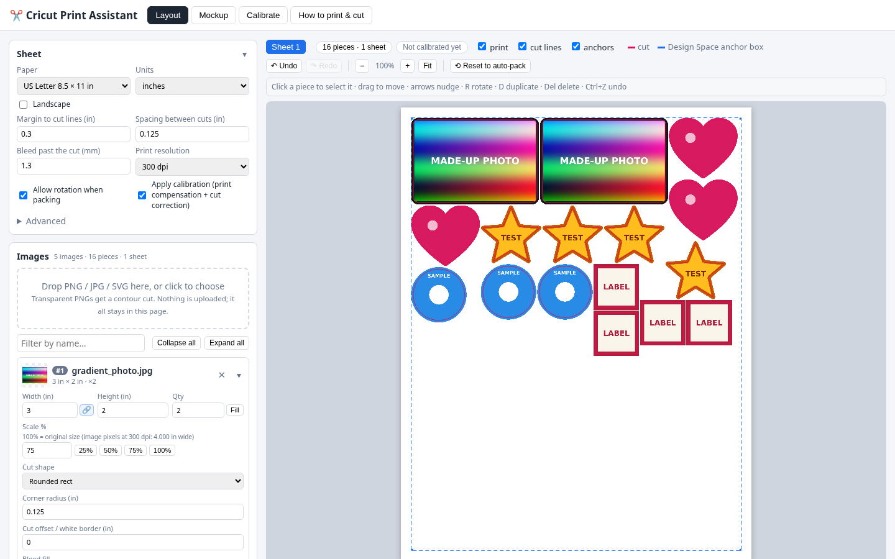
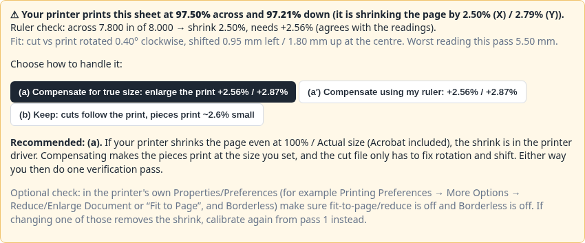
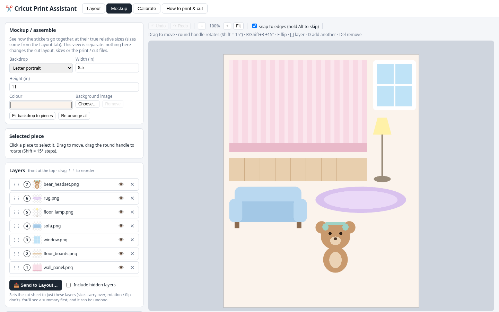
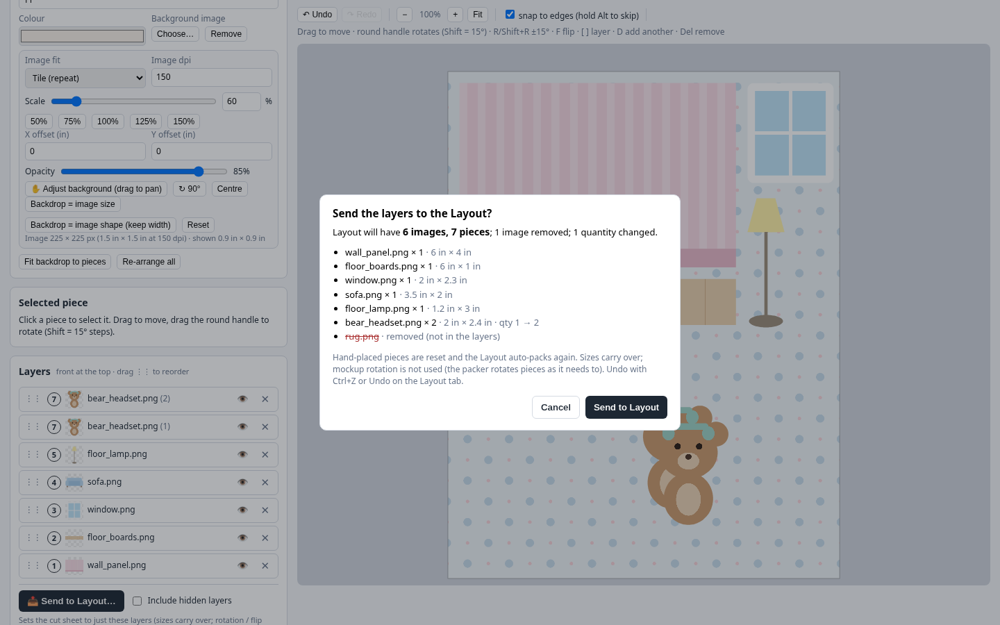
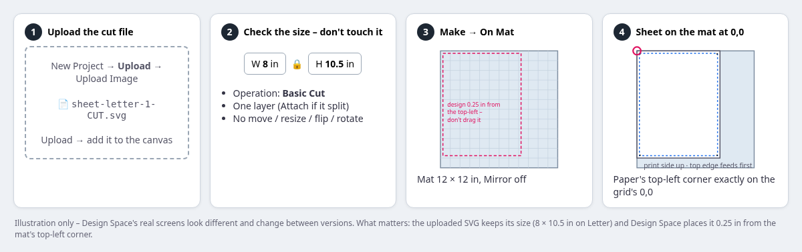

# Cricut Print Assistant

**Full-sheet print & cut for Cricut machines without Print Then Cut.**

Cricut Print Assistant is a single, self-contained, offline web page (`index.html`). Open it in Chrome, Edge or Firefox, either straight from disk or from GitHub Pages. It lays out your stickers or labels on a **full** sheet, gives you a print PDF and a matching cut SVG, and calibrates your printer + cutter so the cuts land on the print.

Nothing is uploaded and there's no server or account: everything runs in your browser.

- **Try it in the browser:** https://icors2.github.io/cricut-print-assistant/
- **Use it offline:** download [`app/cricut_print_assistant.html`](app/cricut_print_assistant.html) (or `index.html`) and double-click it.
- **Step-by-step guide with screenshots:** [docs/GUIDE.md](docs/GUIDE.md)



> Not affiliated with or endorsed by Cricut, Inc. "Cricut" and "Design Space" are trademarks of their owner. Use this at your own risk and always test-cut on scrap paper first.

## Why

Print Then Cut limits a Letter sheet to about 6.75 × 9.25 in (≈ 62 sq in) and needs registration marks. This tool uses the whole sheet minus a small border: the default usable area on Letter is 7.9 × 10.4 in (≈ 82 sq in, about 30% more). Instead of registration marks it relies on a fixed, known placement:

- **Design Space places an uploaded design 0.25 in from the mat's top-left corner** (unless you drag it).
- The cut SVG's canvas is exactly the sheet minus 0.25 in on every side (8 × 10.5 in on Letter), with four 1 mm "pin" squares at its corners. Its size is written in real inches (72 units per inch), so Design Space imports it at true size.
- All cuts are **one compound path**, so Design Space keeps one layer and can't rearrange the pieces.
- You put the printed sheet's top-left corner on the mat grid's **0,0**. Every cut then lands on its print, give or take machine and placement error.
- A **calibration** pass measures what's left over (printer shrink, rotation, shift) and corrects for it.

**Realistic accuracy:** about ±0.5–1 mm after calibration with careful corner placement, occasionally 1.5–2 mm when the mat loads crooked. Designs with a bleed or a 1.5–3 mm white border hide this. A thin printed frame right on the cut line will show it.

## Features

- **Layout**
  - Letter / A4 / Legal / 12×12 sheets, portrait or landscape, inches or mm.
  - Drop in PNG / JPG / SVG images. For each one set width/height (🔗 aspect lock), Scale %, quantity and cut shape: rectangle, rounded or **contour**, which traces transparent PNG/SVG art. A contour offset gives a white sticker border.
  - A bleed (edge colours stretched ≈ 1.3 mm past the cut) hides small drift.
  - Automatic packing with rotation, spilling onto more sheets if needed. **Fill** raises a quantity until the sheet is full.
  - Interactive canvas: drag pieces by hand, with snapping to margins, neighbours and spacing. Rotate, duplicate, delete, nudge with the arrow keys, move between sheets, zoom. Hand placement exports exactly.
  - Undo/redo, collapsible image cards, filter by name, status chips, optional printed piece numbers.
  - Save / open a project file (`.json`, images included).
- **Exports:** a print PDF (300 dpi images, vector-exact placement) and one cut SVG per sheet.
- **Calibration (Calibrate tab):**
  - A guided wizard prints a test sheet with 5 targets and ±8 mm scales. You read where the cut slit crosses each scale, and a least-squares **affine fit** gives size per axis, rotation and shift.
  - A plain-language verdict says what it found. If your printer shrinks the page (some do, even at 100% / Actual size), choose **(a) print compensation**: the PDF is enlarged so the paper comes out true size and the cut only fixes rotation and shift. Or choose **(b) keep**: the cut follows the print.
  - A verification pass, then "✓ Calibrated".
  - Every calibration sheet carries a 4-character **sheet code**, so readings are always analysed against the exact state that sheet was made with. Stale or wrong sheets are caught instead of compounding errors.
  - Bad readings are flagged by name, with fixes such as "X and Y look swapped at T1".
  - Calibration is saved per sheet size in the browser. You can export/import it, it's stored in project files, and you can save a copy of the tool with it built in.
- **Mockup (Mockup tab):** arrange the stickers into the finished scene (for example a dollhouse room) at true relative size.
  - Move, rotate, flip, layer, hide, add copies.
  - Resize with corner handles or typed sizes. Sizes are shared with the Layout tab.
  - Backdrop presets, a colour and a **background image** with Fit / Fill / Stretch / True size / Tile, scale, offset, drag-to-pan, 90° turns and opacity.
  - **Assembly guide** with numbered outlines (PNG, or a true-size PDF).
  - **📤 Send to Layout** turns the Layers list into the cut sheet: same images, qty = number of copies, same sizes.
  - Moving, rotating, flipping and layering in the mockup never change the print/cut files.
- **How to print & cut** tab: the whole workflow and troubleshooting, inside the tool.

| Calibrate | Mockup | Send to Layout |
|---|---|---|
|  |  |  |

## Quick start

1. Open the tool. Pick the paper on the **Layout** tab and drop in your images.
2. Set sizes, quantities and cut shapes. Check the preview: pink lines are cuts, and the blue dashed box is what Design Space will place.
3. **Calibrate once** per printer + paper size + print settings (Calibrate tab). Follow the numbered passes until it says ✓ Calibrated.
4. Click **Print PDF** and **Cut SVG**.
5. Print the PDF at **100% / Actual size**: no "Fit", no borderless. The corner marks should measure 8.000 × 10.500 in on Letter.
6. Cut in Design Space (below).

## Design Space workflow



1. New Project → **Upload** → Upload Image → choose the sheet's `…-CUT.svg` → add it to the canvas.
2. Check the size in the Edit bar. It must read **8 × 10.5 in** (Letter), 7.768 × 11.193 in (A4), 8 × 13.5 in (Legal) or 11.5 × 11.5 in (12×12). Don't move, resize, flip or rotate it. Keep Operation = **Basic Cut** (not Print Then Cut). If it ever shows as several layers, Select All → **Attach**.
3. **Make** → On Mat, with a 12 × 12 mat (Legal: 12 × 24). The design sits 0.25 in from the top-left on the mat preview: **don't drag it**. Mirror stays off.
4. Put the printed sheet **print side up**, top edge toward the feed end, with its top-left corner **exactly on the mat grid's 0,0**. Press it flat, load the mat straight and press Go.

The full illustrated walkthrough is in [docs/GUIDE.md](docs/GUIDE.md).

## Build and test

The app is built from `src/` into one HTML file with the vendored jsPDF inlined:

```bash
python3 build.py          # writes index.html and app/cricut_print_assistant.html
```

The tests run headless in Chrome through puppeteer-core:

```bash
cd test
npm ci                    # puppeteer-core only; uses your installed Chrome
python3 make_samples.py   # made-up sample images (already committed)
python3 make_scene.py     # made-up mockup scene images (already committed)
./run_all.sh              # every test; exits non-zero on the first failure
node docs_shots.js        # regenerate docs/images/
```

Requirements: Python 3 with Pillow + NumPy, Node 18+, Google Chrome at `/usr/bin/google-chrome` (or edit the paths in the tests), and poppler-utils (`pdftoppm`, `pdftotext`, `pdfinfo`). Test outputs go to `sample_output/`, which git ignores.

See [AGENT_HANDOFF.md](AGENT_HANDOFF.md) for the architecture, invariants and conventions.

## Limitations

- Accuracy depends on how exactly the paper sits at 0,0 and how straight the mat loads. Nothing sees the print, unlike Print Then Cut's sensor or a camera-guided cutter.
- The Design Space placement rule (0.25 in from the top-left, uploaded SVGs keep their inch size) is how Design Space behaves today and could change. The calibration absorbs a consistent offset, and Advanced → "Design Space mat margin" exists for other margins.
- The four 1 mm pin squares are cut too, as tiny slits in the waste border. That's intended.
- Contour cuts follow the outer outline only. Interior holes aren't cut, and specks under about 0.03 in are ignored.
- Images (including SVG art) are rasterized at the chosen dpi for printing.
- Calibration lives in the browser's local storage per sheet size. Another browser or PC needs its own calibration, or an import of the exported file.
- Design Space is still needed for the cut step; no third-party software can drive a stock Cricut.

## License

[MIT](LICENSE). The single-file build bundles **jsPDF 2.5.2** (MIT), whose notice is kept inside the built file and listed in [THIRD_PARTY_NOTICES.md](THIRD_PARTY_NOTICES.md). All sample images in this repo are made up and generated by the scripts in `test/`.
