# Cricut Print Assistant – user guide

This guide walks through the whole job: lay out a sheet, calibrate once, print, cut in Design Space, and (optionally) plan a finished scene in the Mockup tab. All pictures were made with the made-up sample images in `test/samples/`.

- [1. Open the tool](#1-open-the-tool)
- [2. Lay out a sheet](#2-lay-out-a-sheet)
- [3. Move pieces by hand](#3-move-pieces-by-hand)
- [4. Export the print PDF and cut SVG](#4-export-the-print-pdf-and-cut-svg)
- [5. Calibrate (once per printer + paper size)](#5-calibrate-once-per-printer--paper-size)
- [6. Print](#6-print)
- [7. Cut in Design Space](#7-cut-in-design-space)
- [8. Mockup: plan the finished scene](#8-mockup-plan-the-finished-scene)
- [9. Background image](#9-background-image)
- [10. Send the mockup to the Layout](#10-send-the-mockup-to-the-layout)
- [11. Saving your work](#11-saving-your-work)
- [12. Use it on an iPad](#12-use-it-on-an-ipad)
- [13. Assets](#13-assets)
- [14. Change colours](#14-change-colours)
- [15. Avatars](#15-avatars)
- [Troubleshooting](#troubleshooting)

---

## 1. Open the tool

- **Online:** https://icors2.github.io/cricut-print-assistant/
- **Offline:** download `app/cricut_print_assistant.html` and double-click it. It's one file with everything inside, so nothing is uploaded anywhere.

The tool has four tabs: **Layout**, **Mockup**, **Calibrate** and **How to print & cut**. The last one is a short version of this guide, built into the tool.

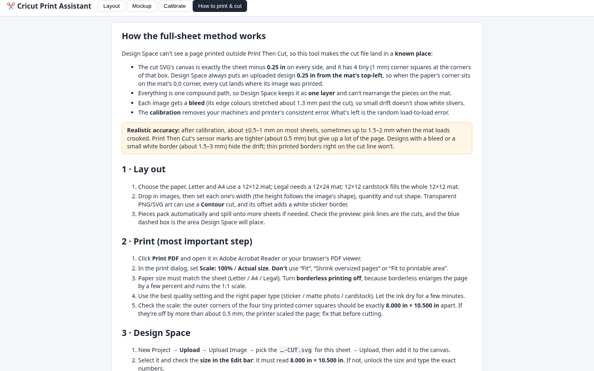

## 2. Lay out a sheet

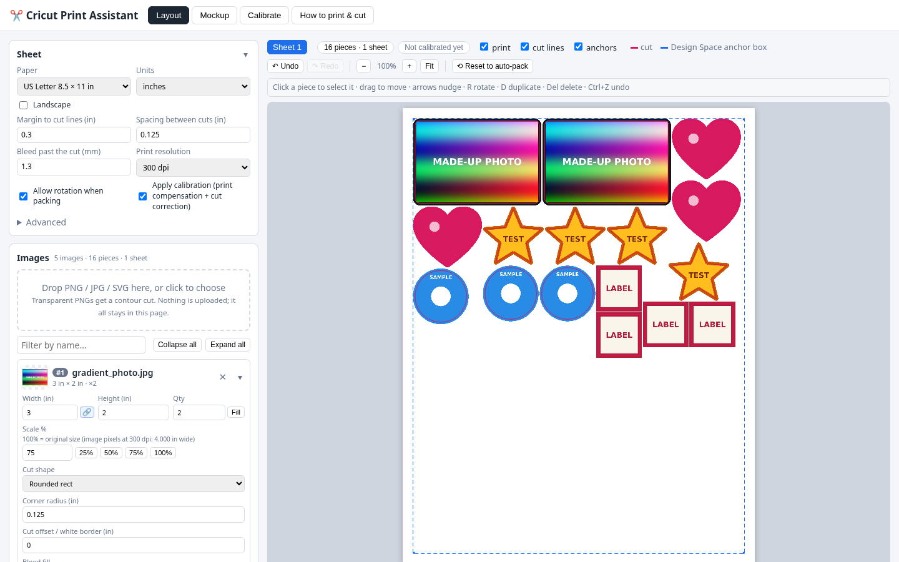

1. In the **Sheet** panel choose the paper: Letter, A4, Legal or 12×12, portrait or landscape, inches or mm. The defaults (0.3 in margin, 0.125 in spacing, 1.3 mm bleed, 300 dpi) suit most sticker paper.

   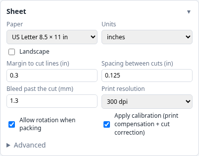

2. Drop PNG / JPG / SVG files on the drop zone, or click it to choose files.
3. Each image gets a card:
   - **Width / Height** with the 🔗 link: on, the ratio is kept; off, they change separately.
   - **Scale %**: 100% = the image's pixel size at the print dpi. Use the 25/50/75/100% buttons.
   - **Qty**. **Fill** raises it until the current sheet(s) are full.
   - **Cut shape**: Rectangle, Rounded rect, or **Contour**, which follows the outline of transparent PNG/SVG art.
   - **Cut offset / white border**: grows a white sticker border around a contour.
   - **Bleed fill**: edge colours are stretched past the cut so small drift never shows white.
   - **Allow 90° rotation** while packing.

   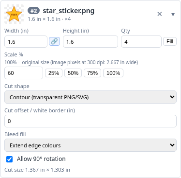

4. Pieces pack automatically and spill onto more sheets if needed. In the preview, pink lines are cuts and the blue dashed box is the area Design Space will place.
5. Chips above the canvas show pieces/sheets and the calibration state; click one for details.

   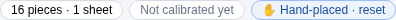

Cards collapse with their chevron. **Collapse all / Expand all** and **Filter by name** help with long lists.

## 3. Move pieces by hand

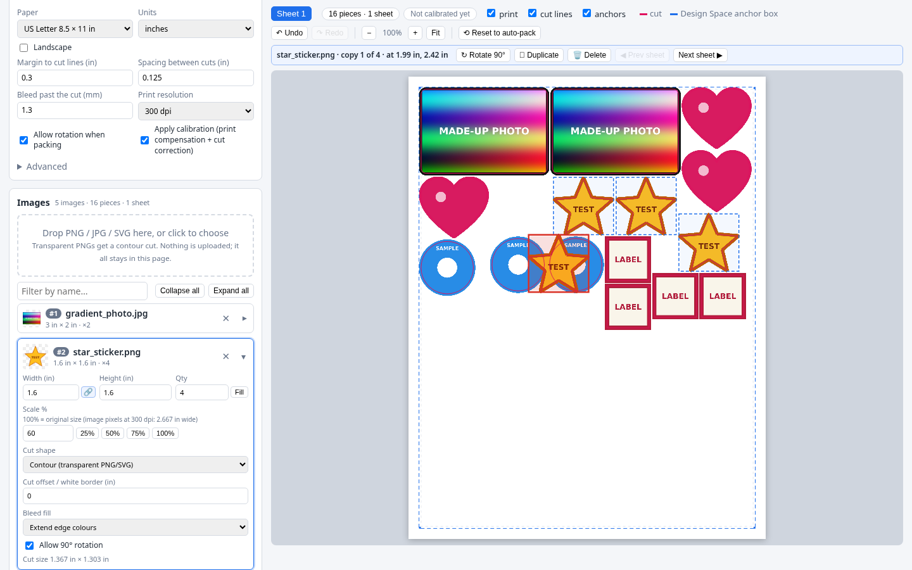

- Drag any piece. It snaps to the margins, to neighbours' edges and to exactly the spacing from a neighbour. Pieces can't leave the usable area or overlap.
- Clicking a piece selects it and highlights its card. The bar above the canvas has **↻ Rotate 90°**, **⧉ Duplicate**, **🗑 Delete** and **◀ Prev / Next sheet ▶**.
- Keys: arrows nudge (Shift ×4), **R** rotates, **D** duplicates, **Del** deletes, **Ctrl+Z / Ctrl+Y** undo/redo.
- Zoom with − / + / Fit or Ctrl + mouse wheel. **⟲ Reset to auto-pack** forgets hand placement.

Hand-placed positions are exported exactly: the print and the cut use the same positions.

## 4. Export the print PDF and cut SVG

Click **Print PDF** and **Cut SVG** in the Export panel. You get one PDF (one page per sheet) and one cut SVG per sheet. The file names carry the paper and sheet number.

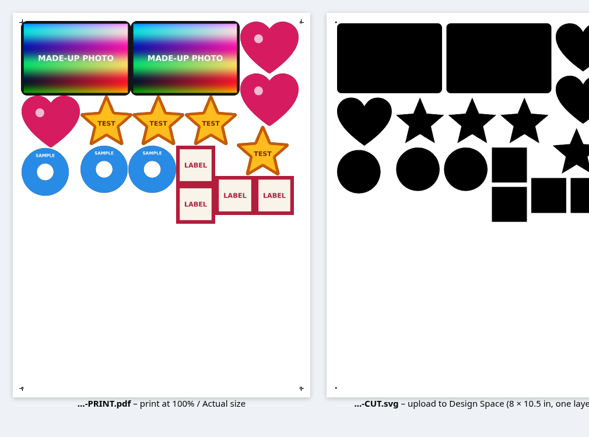

- The **print PDF** is the full sheet with your images (plus bleed) and four tiny corner marks.
- The **cut SVG** is 8 × 10.5 in on Letter (the sheet minus 0.25 in on each side). It holds all cuts as one compound path, plus four 1 mm corner squares that pin its size and position. Don't edit it.

Optional: **Print piece numbers** adds a tiny number next to each sticker on the print. The cut file isn't affected.

- With a mockup, the number is the piece's **assembly step** from the Mockup guide, so the sticker labelled 7 on the sheet is step #7 in the guide ([section 8](#8-mockup-plan-the-finished-scene)).
- Copies of the same image are identical, so they share out that image's steps in reading order: sheet 1 first, then top to bottom, left to right. Any copy works for any of its steps.
- Pieces beyond the copies in the mockup (a higher qty) print **sp**, for spare.
- With no visible mockup pieces, the number is the image's position in the list.
- Each image card's badge shows what will print, e.g. `#4,#8,#9`.

## 5. Calibrate (once per printer + paper size)

Printers often shrink or shift the page slightly, and the mat never loads perfectly square. The calibration measures this once and corrects every future file.

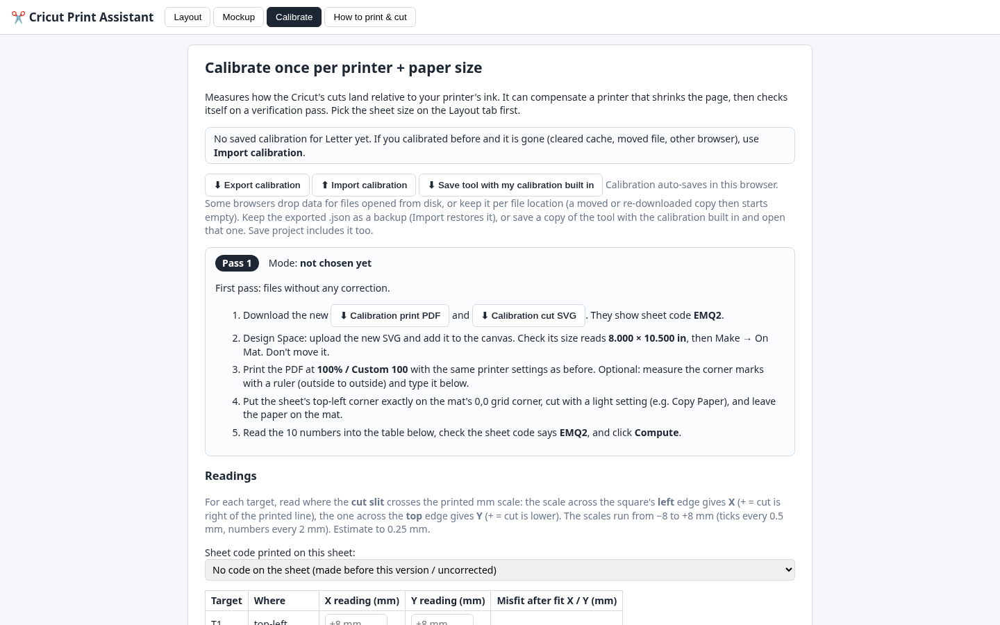

**Pass 1**

1. Click **Calibration print PDF** and **Calibration cut SVG**. Both show a 4-character **sheet code**.
2. Print the PDF at 100% / Actual size. Upload the SVG to Design Space and cut it exactly like a normal sheet (see [section 7](#7-cut-in-design-space)), on plain paper with a light setting. Leave the paper on the mat.
3. Each of the 5 targets has two mm scales. Read where the **cut slit** crosses the scale across the square's left edge (**X**, + = cut is right of the printed line) and the one across its top edge (**Y**, + = cut is lower). Estimate to 0.25 mm.

   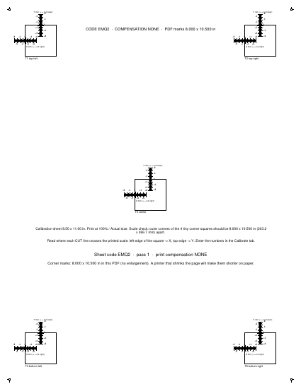

4. Pick the sheet code printed on that sheet, type the 10 numbers, and optionally the ruler distance between the outer corner marks (expected 8.000 × 10.500 in on Letter). Click **Compute & check**.

   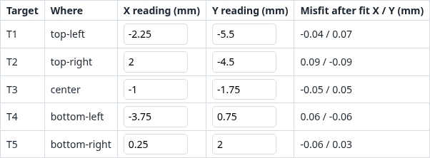

**Verdict.** The tool fits the readings (size per direction, rotation, shift) and explains the result in plain words, with a "misfit" per target. A big misfit means a mis-read target, and the tool names it. If your printer shrinks the page, it offers a choice:

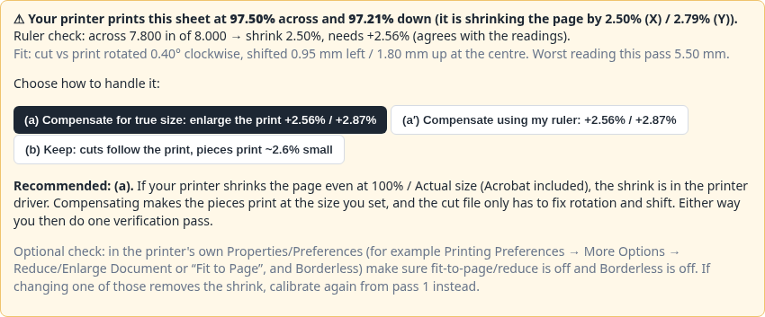

- **(a) Compensate for true size (recommended):** the print PDF is enlarged by exactly the shrink, so pieces print at the size you set. The cut file then only corrects rotation and shift.
- **(b) Keep:** no enlargement; the cuts follow the slightly small print.

**Pass 2 (verification).** The checklist tells you which files to use. They have a new sheet code, and the old ones are out of date. Delete the old calibration image in Design Space, then print, cut and read again. When every reading is within the tolerance (±0.5 mm by default) you'll see **✓ Calibrated**.

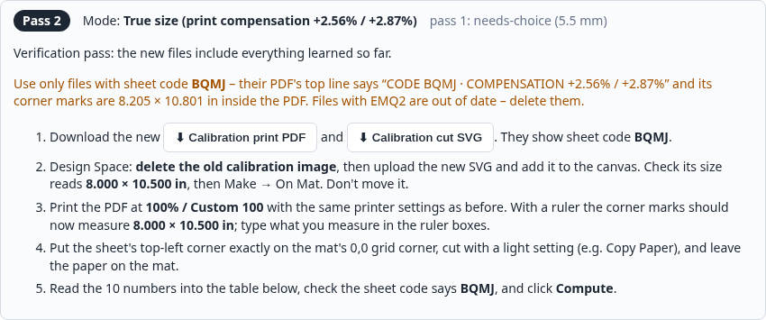

Good to know:

- The calibration is saved in this browser per sheet size. Use **Export calibration** to keep a backup file, **Import calibration** on another computer, or **Save tool with my calibration built in** for a personal copy.
- Sheet codes prevent mix-ups. If you enter readings from an old sheet, the tool says so instead of saving a wrong correction.
- "Apply calibration" on the Layout tab turns the correction on for real sheets. It's on by default once you've calibrated.

## 6. Print

- Open the PDF in Adobe Acrobat Reader or your browser's PDF viewer.
- **Scale: 100% / Actual size.** Never "Fit", "Shrink oversized pages" or "Fit to printable area".
- The paper size must match. Turn **borderless off**, because it enlarges the page.
- Use the best quality and the right paper type, and let the ink dry.
- Check: the outer corners of the four printed corner marks should be exactly 8.000 × 10.500 in apart on Letter. If you calibrated with compensation, they come out true size on paper.

## 7. Cut in Design Space

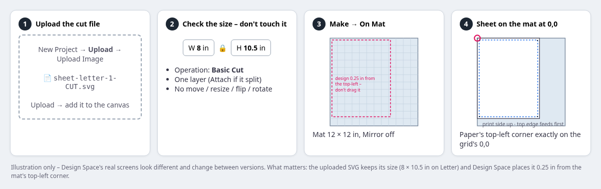

*Illustration only: Design Space's real screens look different and change between versions.*

1. **New Project → Upload → Upload Image**, choose the sheet's `…-CUT.svg`, upload it and add it to the canvas.
2. Select it and check the size in the Edit bar: **8 × 10.5 in** on Letter (A4 7.768 × 11.193, Legal 8 × 13.5, 12×12 11.5 × 11.5). If it differs, unlock the size and type the exact numbers. Keep the Operation as **Basic Cut**. Don't move, resize, flip or rotate it. If it shows as several layers, **Select All → Attach**.
3. **Make → On Mat**, 12 × 12 mat (Legal: 12 × 24). On the mat preview the design sits in the top-left corner, 0.25 in from each edge. **Don't drag it.** Mirror off.
4. Choose the material and use a sticky mat.
5. Put the printed sheet **print side up**, top edge toward the end that feeds first, with its **top-left corner exactly on the mat grid's 0,0** (top edge on the top grid line, left edge on the left grid line). This is the alignment, so take your time.
6. Press it flat, load the mat straight and snug against the guides, and press Go.
7. Before unloading you can look at the corner squares: the small cut squares should sit on the printed corner marks.

## 8. Mockup: plan the finished scene

Every sidebar panel on the Mockup tab collapses: click its title or the ▾ chevron. These are Mockup / assemble (page size + background image), Layers, Images, Assembly guide & export, and Save work. A collapsed panel shows a one-line summary, such as *Letter portrait · bg: wallpaper.png Tile* or *Guide: ghost · numbers all*, and the tool remembers which panels you closed.

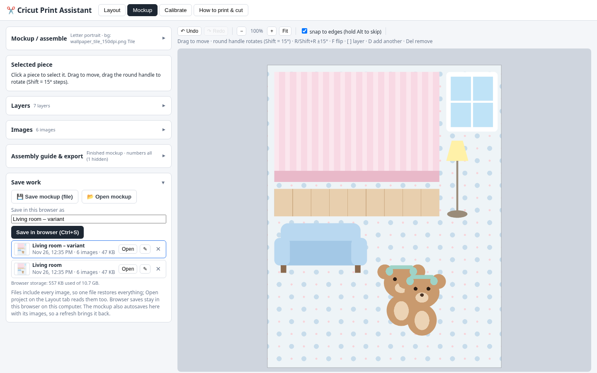

The **Mockup** tab shows how the stickers go together, for example a dollhouse room, at their true relative sizes.

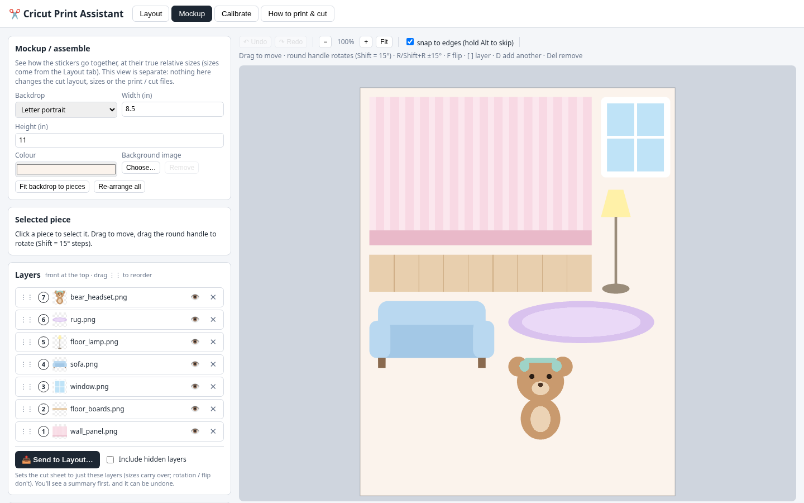

- **Move**: drag. Pieces snap to each other and to the backdrop; hold Alt to skip snapping.
- **Rotate**: drag the round handle (Shift = 15° steps), or use the angle box and buttons. **⇋ Flip** mirrors a piece.
- **Layers**: To front / Forward / Backward / To back, or drag the ⋮⋮ handle in the Layers list. 👁 hides a piece.
- **+ Add another** places more copies. The Images panel also has its own drop zone; new images join the Layout tab with qty 1.
- **Resize**: drag a corner square of the selected piece. The ratio is locked; Shift or the 🔗 button unlocks it. Or type Width / Height / Scale %. A size is shared: it applies to every copy, to the Layout tab and to the cut sheet.

  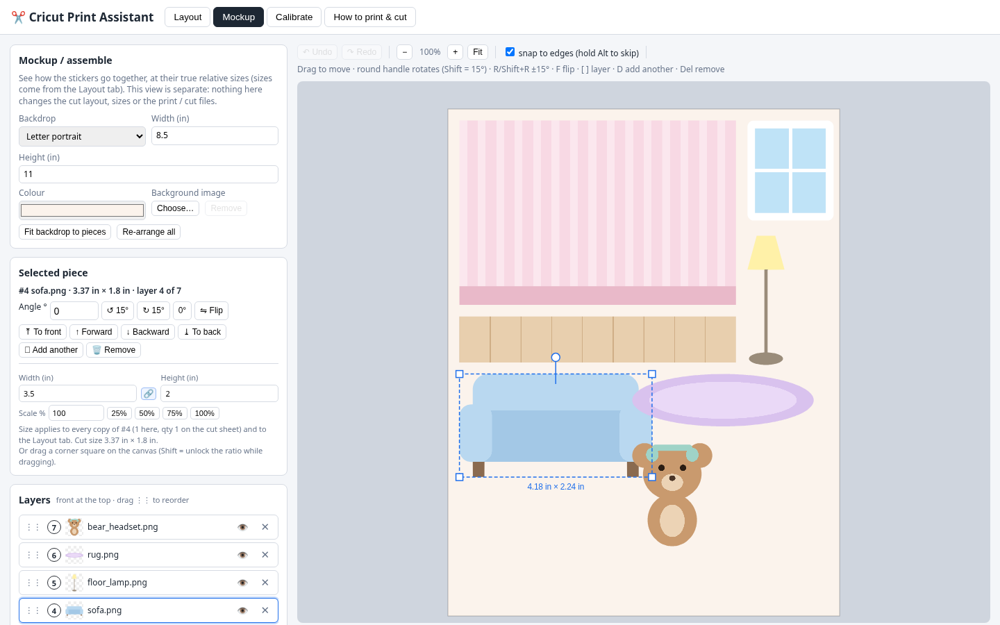

- **Transform: skew / free distort**: sometimes a sticker is drawn for a slightly different angle than the scene, like an isometric dollhouse railing that's a little off the angled floor edge. Select the piece and turn on **⬚ Transform** in *Selected piece*.
  - Drag a **corner** circle to move that corner on its own: a perspective warp of the whole image.
  - Drag a **side's middle square** to skew. You can also type **Skew X° / Y°**.
  - **Ctrl/⌘ + drag a corner** works without Transform mode. **Reset transform** puts it back, and Esc leaves Transform mode.
  - The canvas, the Mockup PNG and the guide outlines (PNG and PDF) all follow the warped shape.
  - *Warp applies to the printed sticker.* The Layout updates right away and prints and cuts the warped shape.
    - The picture is re-drawn at print resolution through the warp, and the cut line goes through exactly the same mapping, so they line up.
    - The cut size becomes the warped shape's bounding box. The width/height on the Layout card stay the size before the warp.
    - The Layout card says the image is warped and has a **Remove warp** button.
  - **Copies:** a warp belongs to the image.
    - If copies of one image have different warps, the Layout uses the warp most copies share for now. The note in *Selected piece* tells you.
    - **Send to Layout** then gives the other copies their own entry, e.g. *railing.png (warped 2)*.
  - Calibration, sheet codes and the anchors aren't affected.
  - Undo covers it, and saves and projects keep it.

  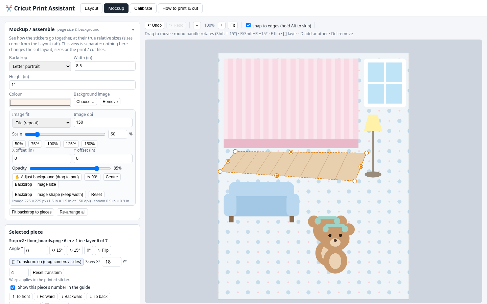

  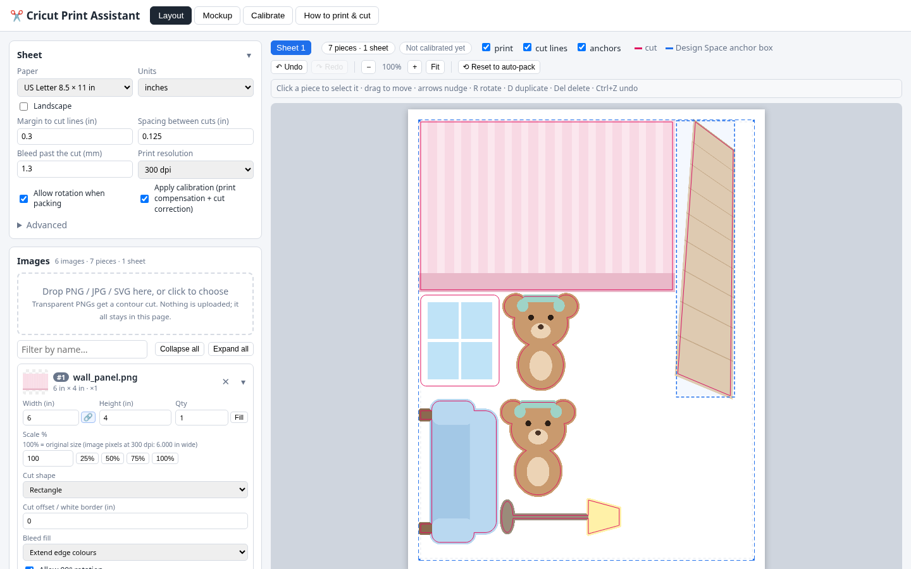

- **Assembly guide**: set *Show* to "numbered outlines" or "ghosted images + numbered outlines".

  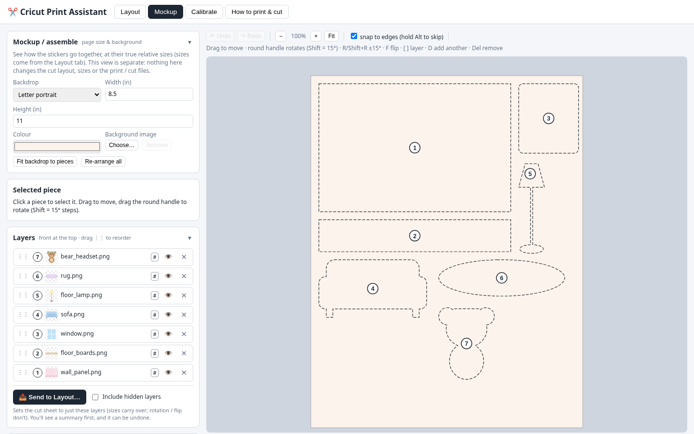

  - **The numbers are the order to stick them on.** #1 is the bottom-most visible layer and goes on first. The top layer gets the highest number, so every sticker goes over the ones it overlaps.
  - Each copy has its own step; hidden (👁) layers are skipped, so the steps always run 1, 2, 3… with no gaps.
  - Reorder the layers and the steps renumber at once. The Layers list shows each layer's step in its circle, and *Selected piece* shows "Step #n".

- **Crowded spots**: when lots of small stickers sit close together, the numbers become unreadable.
  - Click the **#** button next to a layer's eye, or untick **Show this piece's number in the guide** under *Selected piece*. That number disappears from the canvas, the Guide PNG and the Guide PDF.
  - The piece keeps its outline and its step. Its legend row stays too, marked "number not shown on the picture", so the order is still complete.
  - **Numbers: None** hides all numbers (outlines + legend only). **Number size** scales the badges (50–200%), and **Show all numbers** brings every number back.
  - All of this is saved with the mockup and in project files, and Undo covers it.

  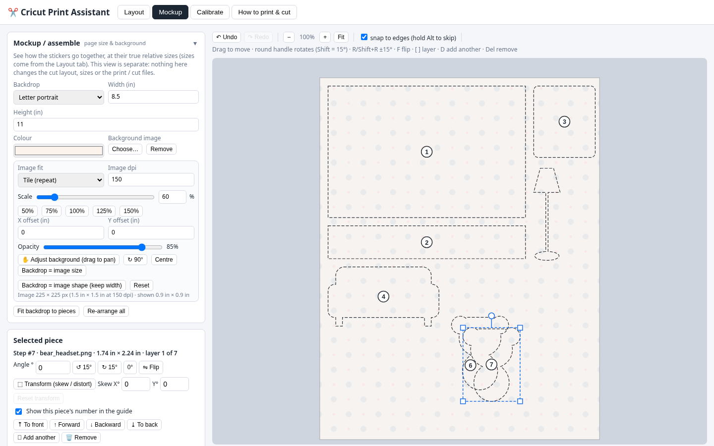

- **Exports**: Mockup PNG, Guide PNG and Guide PDF.
  - Both guides have a legend: one row per step, in order, with the step number, a thumbnail, the image name and its size.
  - The PDF prints at true size, so you can lay the stickers on it.

  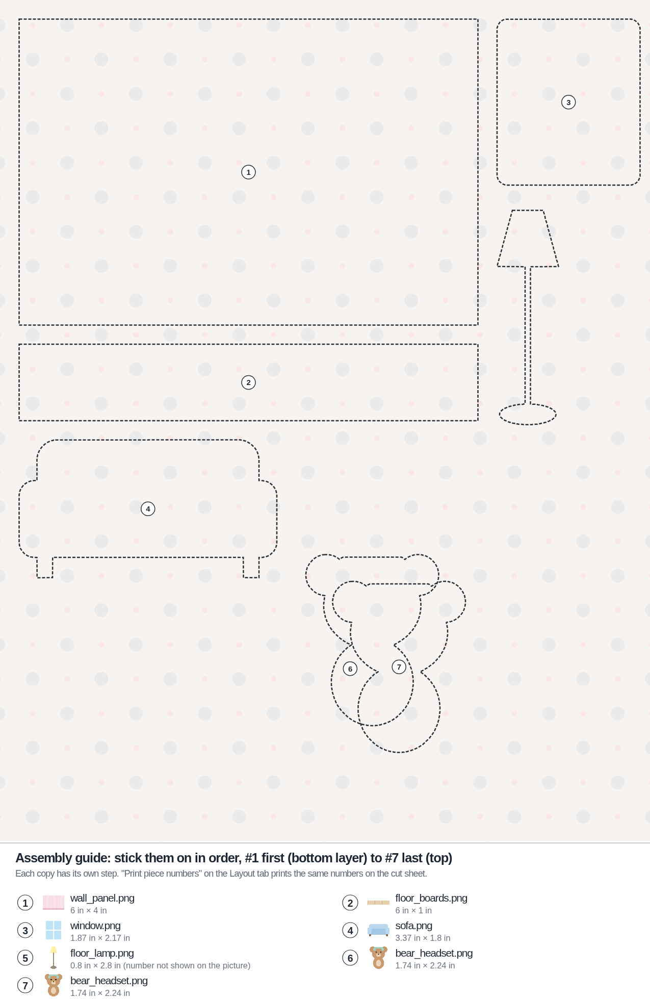

Moving, rotating, flipping, layering and hiding never change the print PDF or the cut SVG. Only size changes do, on purpose.

## 9. Background image

Choose a background image in the Mockup panel. Its sizing controls appear underneath:

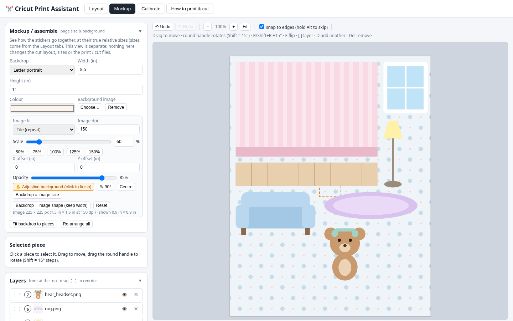

- **Image fit**:
  - *Fit*: the whole image, may leave margins.
  - *Fill*: covers the page, crops the edges.
  - *Stretch*: exactly the page.
  - *True size*: at the image's dpi.
  - *Tile*: repeats at true size.
- **Image dpi** is read from the file when it has one, otherwise 150.
- **Scale %**, **X / Y offset**, **Centre**, **↻ 90°** turns and **Opacity**.
- **✋ Adjust background**: while it's on, dragging on the canvas moves the background instead of the stickers. Press Esc to finish.
- **Backdrop = image size** makes the backdrop exactly the image at its dpi. **Backdrop = image shape** keeps the width and matches the image's proportions.
- **Reset** and **Remove**.

The same placement is used in the Mockup PNG and the guides.

## 10. Send the mockup to the Layout

When the scene looks right, **📤 Send to Layout…** (under the Layers list) makes the cut sheet match it:

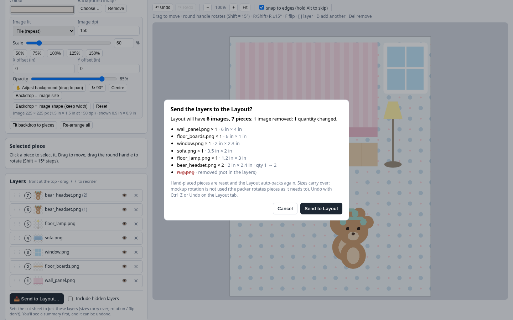

- The Layout gets exactly the images in the Layers list. Each qty = its number of copies there, and sizes are unchanged.
- Images not in the layers are removed from the Layout.
- Hidden layers are skipped unless you tick **Include hidden layers**.
- Mockup rotation and flips aren't carried over: the packer rotates pieces as needed, and pieces print unflipped.
- A summary appears first. After you confirm, the Layout tab opens and auto-packs. **Undo** on the Layout tab reverts everything in one step.

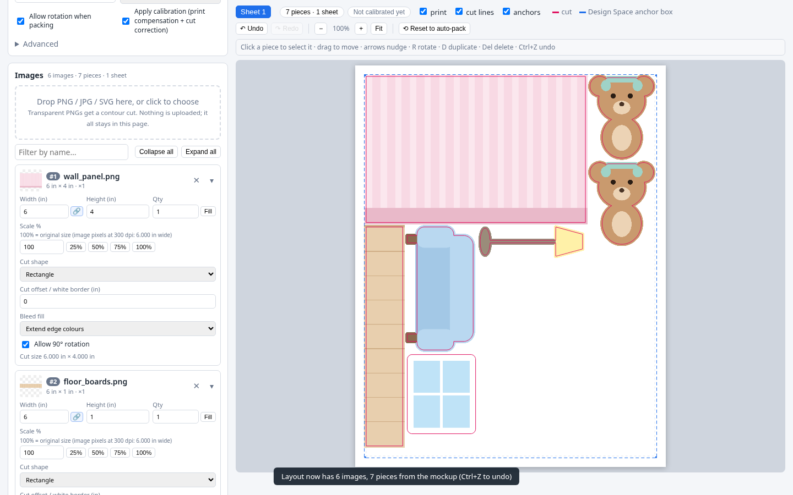

## 11. Saving your work

- **Save project / Open project** (Layout tab) stores the images, sizes, quantities, hand placement, the mockup and the calibration in one `.json` file.
- **Mockup tab → Save work** panel:

  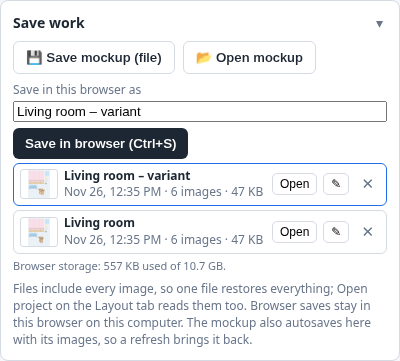

  - **💾 Save mockup (file)** downloads one `.json` file with everything:
    - every image (embedded) with its size and cut settings;
    - the layers with their positions, angles, flips, order and visibility, plus hidden numbers;
    - the guide options and the backdrop with its background image.

    It's the same format as a project file, so **Open project** reads it too.
  - **📂 Open mockup** brings it all back on any computer, with no re-upload. Unlike Open project, it keeps this browser's sheet settings and calibration.
  - **Save in browser** (or **Ctrl+S** on the Mockup tab) stores a named copy, images included, in this browser.
    - The list shows a thumbnail, date, image count and size, with **Open**, **✎ rename** and **✕ delete**.
    - Saving again under the same name overwrites that save.
  - The panel shows how much browser storage is used and warns when it's almost full. Browser saves are big because they hold the images; keep the important ones as files.
- **Autosave:** the calibration, the settings and the whole mockup, images included, are saved in the browser as you work, so a refresh brings everything back. Clearing the site's data starts fresh. If the browser can't store the images, re-add the same files or open a save, and the mockup reconnects them by name.

## 12. Use it on an iPad

Open the site in Safari, then Share → Add to Home Screen. The icon is "Sticker Studio" and the app opens full screen.

- Pinch with two fingers on the selected piece to resize it, and twist to rotate. One undo puts both back.
- Pinch empty space to zoom the view. The page itself does not zoom.
- A long-press shows Undo, Duplicate, Delete, layer, flip and rotate.
- Buttons are larger on a touch screen.
- Save a PDF or SVG through the share sheet (Save to Files or AirDrop).
- A very large picture is printed at a lower dpi instead of crashing the tab. The note under the dpi field says so.
- A HEIC photo is not accepted. Use a PNG or JPG (on iPhone: Settings → Camera → Formats → Most Compatible).

Kid mode, which turns on by itself on a touch screen, shows Assets and Mockup. Hold **Grown-ups** for 2 seconds to get Layout, Calibrate and How to back.

## 13. Assets

The Assets tab lists starter drawings. Tap one to add it to the Mockup at its catalog size. A second tap of the same drawing adds another copy, not a new file. Long-press for the size, the licence and **Add to scene**.

Search ignores accents, so "cafe" finds "café". Rooms can be the Mockup background.

**Extract from a picture** is on the web version. Choose a picture, drag a box around one thing, and optionally remove a plain background. Type a name, pick a category, and type the write token the first time. **Save to library** puts it in the shared catalog. It does not land on the sheet until you tap the new tile. Family photos do not belong in this library.

**+ Import pack** reads a `.cpapack.zip` or `.cpapack.json`. A private pack stays in this browser and can be exported or deleted. It is never part of the public site.

The five drawings here are placeholders. A larger set is still to come.

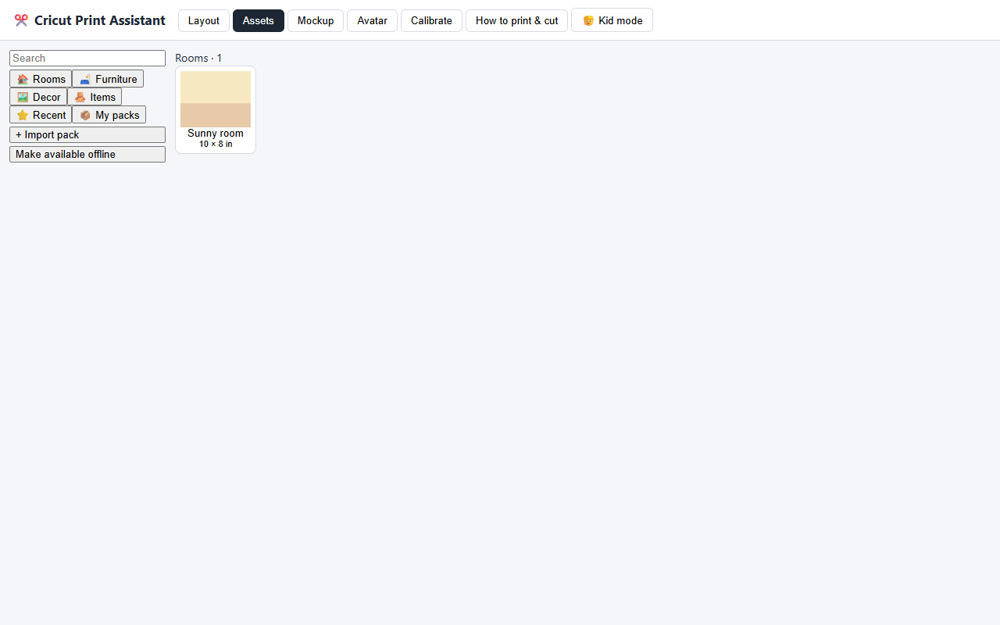

## 14. Change colours

Open **🎨** on a drawing that has colour parts (from its details, from the Mockup, or from its Layout card). Pick a palette swatch or a colour. **Surprise** chooses from that drawing's palettes. **Done** updates the picture. **Only this copy** makes a new image so the other copies stay as they were.

The cut line does not move. Undo puts the previous colours back.

## 15. Avatars

The Avatar tab is turned off for now. A sticker that was already made from it still prints and cuts.

## Troubleshooting

- **Everything is off by the same amount:** calibrate, or check that the paper really sat at 0,0.
- **Cut is 2–3% bigger than the print, worse toward the edges:** the printer shrinks the page. Look for "Fit to printable area", "Scale to fit" or "Reduce/Enlarge" in the printer's own settings and turn it off, or print from Acrobat at *Actual size*. If it still shrinks, use calibration option **(a) Compensate**.
- **The error grows across the page:** the page printed scaled, or the mat loaded crooked.
- **Design Space shows the wrong size:** type in the exact size; never use the size handles.
- **Design Space moved the design:** undo or Make again. It must stay at the default 0.25 in spot.
- **"Too large for 12×12 mat":** choose 12 × 24 (Legal) or check the sheet setting.
- **A calibration reading is flagged:** re-read that target. The tool also offers "Drop T# and save" and spots swapped X/Y values.
